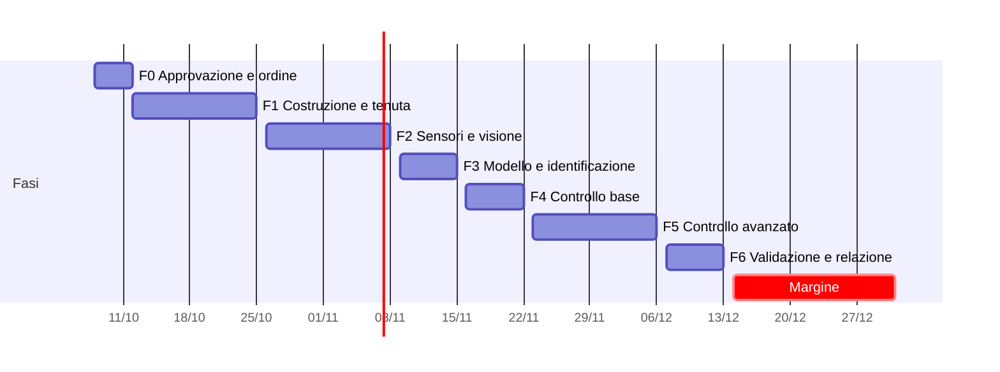

# Piano operativo: il Palombaro di Cartesio controllato

> **Come usare questo documento.** Le sottofasi si affrontano una alla volta, nell'ordine indicato.
> Per lavorarci insieme scrivi, ad esempio, *"facciamo la 2.3"*: prima controlliamo i prerequisiti,
> poi la svolgiamo e alla fine spuntiamo le caselle e aggiorniamo il diario.
> Le attività sono definite qui, ma non sviluppate: il "come" lo decidiamo nella sottofase stessa.
>
> **Stato:** `[ ]` da fare · `[~]` in corso · `[x]` fatta · `[-]` saltata (con motivo nel diario)

**Obiettivo:** costruire un banco fisico in cui un diavoletto di Cartesio viene mantenuto a una quota scelta da un controllore in retroazione, e confrontare sperimentalmente On-Off, PID e PID in cascata.

**Architettura:** iPhone (Continuity Camera) → Mac con Python/OpenCV (misura della quota, filtro, interfaccia, registrazione) → seriale USB → ESP32 (anelli di controllo, macchina a stati, lettura BMP280, comando del servo) → siringa → pressione nella bottiglia → palombaro.

**Strumenti:** ESP32 + PlatformIO (C++), Python 3 (OpenCV, pyserial, numpy, matplotlib), MATLAB + Control System Toolbox + Simulink, LaTeX per la relazione, git per il versionamento.

**Documenti di riferimento:**
- Proposta approvata: `Proposta progetto/Proposta_Palombaro_Cartesio_Caruso.pdf`
- Simulazione di riferimento (modello, controllori, macchina a stati): `landing/sim.js` e la landing pubblicata

---

## Vincoli globali

Valgono per **tutte** le sottofasi.

| Vincolo | Valore |
|---|---|
| Consegna interna | **domenica 13 dicembre 2026** |
| Scadenza del professore | fine dicembre 2026 (14–31 dic = solo margine per correzioni, nessuna funzione nuova) |
| Budget | ≈ 70 € previsti, tetto massimo 90 € (piano B compresi) |
| Criteri di successo (dal foglio A4) | errore RMS di quota < 5 mm su 3 setpoint; gradino di 5 cm con assestamento < 10 s e sovraelongazione < 20 %; disturbo recuperato in < 10 s; fail-safe verso SAFE |
| Livelli di risultato | **Base** (On-Off + PID su un anello + macchina a stati) garantito entro F4 · **Target** (cascata, PID digitale completo, filtro, SFC, analisi real-time) entro F5 · **Extra** solo se si è in anticipo |
| Hardware fissato | ESP32 DevKit, servo MG996R, BMP280, siringa **20 ml** (decisa il 18 ott al posto della 10 ml), bottiglia PET 1,5 L, bottiglia extra da 0,5 L con 500 ml d'acqua (circa 50 ml d'aria: il volume si regola con l'acqua), iPhone 15 Pro come telecamera |
| Frequenze di progetto | anello interno (pressione) 100 Hz · anello esterno (quota) 30 Hz, la frequenza della telecamera |
| Lingua | documentazione, codice commentato e relazione in italiano |
| Sicurezza | elettronica mai sopra l'acqua né sotto la bottiglia; il banco sta in una vaschetta di contenimento; servo alimentato a parte (5 V), con masse in comune; nessun test elettrico con la bottiglia aperta sopra la breadboard |

## Calendario di riferimento

| Data | Evento |
|---|---|
| gio 8 – dom 11 ott | preparazione dell'incontro |
| **lun 12 ott, mattina** | **incontro con il prof (approvazione)** |
| lun 19 ott | lezione in aula magna (8:30–11:00) |
| lezioni ordinarie | lunedì 8:30–12:00 · giovedì 8:30–10:00 |
| **mer 11 – mar 17 nov** | **pausa delle lezioni** (finestra intensiva per F3) |
| mar 8 dic | festivo (Immacolata) |
| **dom 13 dic** | **consegna interna (M6)** |
| mar 15 dic | fine delle lezioni |
| 14 – 31 dic | margine, correzioni, consegna ufficiale |

## Panoramica delle fasi

| Fase | Periodo | Ore stimate | Milestone |
|---|---|---|---|
| **F0** Approvazione e ordine | gio 8 → lun 12 ott | ~5 h | M0 · progetto approvato e componenti ordinati |
| **F1** Costruzione e tenuta | lun 12 → dom 25 ott | ~20 h | **M1** · il palombaro si muove con la siringa comandata dal servo |
| **F2** Sensori, visione, registrazione | lun 26 ott → dom 8 nov | ~18 h | **M2** · quota e pressione registrate ad almeno 20 Hz |
| **F3** Modello e identificazione | lun 9 → dom 15 nov | ~14 h | **M3** · G(s) validata sui dati |
| **F4** Controllo base | lun 16 → dom 22 nov | ~13 h | **M4** · quota stabile (livello Base raggiunto) |
| **F5** Controllo avanzato | lun 23 nov → dom 6 dic | ~20 h | **M5** · ±5 mm e inseguimento (livello Target) |
| **F6** Validazione, video, relazione | lun 7 → dom 13 dic | ~20 h | **M6** · consegna interna |
| Margine | lun 14 → gio 31 dic | — | consegna ufficiale |

**Totale ≈ 110 ore, circa 12 ore a settimana.** È più delle 60–80 ore stimate nella proposta, perché qui sono contati anche relazione, video, documentazione e revisioni. Il livello Extra non è incluso.



### Percorso critico

Sono le sottofasi che, se ritardano, fanno slittare la consegna. Le altre hanno qualche giorno di gioco.

**1.2 → 1.3 → 1.4 → 1.5 → 1.6 → 1.8 → 2.2 → 2.5 → 2.6 → 2.7 → 3.3 → 3.4 → 4.4 → 4.5 → 5.2 → 5.8 → 6.1 → 6.4**

---

## Attività trasversali (valgono per tutto il progetto)

### T1 · Diario di laboratorio
- [ ] Per ogni sessione di lavoro, una voce in `diario.md`: data, ore impiegate, sottofase, cosa è stato fatto, problemi, decisioni prese, foto.
- **Perché:** è la fonte della relazione, e ti salva quando non ricordi perché hai scelto un valore.

### T2 · Versionamento e backup
- [ ] Un commit git alla fine di ogni sessione, con messaggio nel formato `tipo: descrizione` (ad esempio `feat: lettura BMP280 a 100 Hz`).
- [ ] Copia di sicurezza su un repository privato o in cloud almeno una volta a settimana.

### T3 · Foto e video
- [ ] Foto di ogni passo costruttivo (servono per il capitolo sul banco).
- [ ] Un video breve a ogni milestone (M1–M5): sono anche la prova di avanzamento da mostrare al prof.

### T4 · Relazione progressiva
- [ ] Ogni fase produce la bozza del suo capitolo. Così in F6 si rifinisce soltanto, non si scrive da zero (la mappa è in fondo al documento).

### T5 · Revisione settimanale (domenica sera, 20 minuti)
- [ ] Controllare la milestone della settimana: raggiunta o no?
- [ ] Sommare le ore della settimana e confrontarle con la stima.
- [ ] Aggiornare il registro dei rischi.
- [ ] Fissare le sottofasi della settimana successiva.
- **Regola di ritardo:** se una fase slitta di più di 3 giorni si applica il piano B del rischio corrispondente. Se slitta di più di 5 giorni si tagliano prima gli Extra, poi gli elementi Target nell'ordine della sezione "Ordine dei tagli".

### T6 · Aggiornamenti al professore (se concordati il 12 ottobre)
- [ ] Un breve messaggio con il video dopo M2 (circa 8 nov) e dopo M4 (circa 22 nov).

---

## F0 · Approvazione e ordine (gio 8 → lun 12 ott)

### 0.1 · Preparare l'incontro con il prof
- **Quando:** gio 8 → dom 11 ott · **Scadenza:** dom 11 ott · **Impegno:** ~1,5 h · **Prerequisiti:** foglio A4, landing
- **Obiettivo:** arrivare lunedì con proposta, demo e domande pronte.
- **Attività:**
  - [ ] Stampare il foglio A4 in 2 copie (una da lasciare al prof).
  - [ ] Preparare la demo della landing su laptop o telefono, più un piano B senza rete: una registrazione schermo di 60 secondi.
  - [ ] Scrivere un discorso di presentazione di 60–90 secondi: problema, perché è instabile, cosa si controlla, cosa si dimostra del corso.
  - [ ] Scrivere l'elenco delle domande (vedi "Output").
  - [ ] Provare il discorso ad alta voce almeno una volta.
- **Output:** A4 stampato, demo pronta, `Piano operativo/domande-prof.md` con queste domande:
  formato della consegna (relazione, demo dal vivo, video, orale?) · lunghezza o modello della relazione · scadenza esatta e canale di consegna (Classroom?) · quale parte d'esame viene esonerata · vincoli sugli strumenti (MATLAB, ESP32 o Arduino) · dove fare la demo (in aula? va portato il banco?) · possibilità di un controllo intermedio a metà novembre · interesse per un eventuale proseguimento nel corso di Laboratorio di automatica.
- **Fatto quando:** il discorso dura meno di 2 minuti e le domande sono scritte.

### 0.2 · Preparare il carrello acquisti
- **Quando:** gio 8 → dom 11 ott · **Scadenza:** dom 11 ott · **Impegno:** ~1,5 h · **Prerequisiti:** distinta componenti del foglio A4
- **Obiettivo:** poter ordinare tutto in 10 minuti subito dopo l'approvazione.
- **Attività:**
  - [ ] Distinta definitiva con link, quantità e prezzo per ogni componente.
  - [ ] Ricambi: 2 BMP280, 3–4 siringhe, 2 m di tubo, 2 raccordi a T, più contagocce.
  - [ ] Utili da valutare: bilancino 0,01 g (per tarare il palombaro), vaschetta di contenimento, supporto per l'iPhone.
  - [ ] Dividere tra Amazon (elettronica, consegna in 1–2 giorni), farmacia (siringhe, contagocce) e ferramenta (epossidica, legno, fascette, filo di rame).
  - [ ] Controllare il totale: ≤ 90 € compresi i ricambi.
- **Output:** `hardware/distinta-componenti.md`.
- **Fatto quando:** carrello Amazon pronto ma **non ancora ordinato**, e lista per farmacia e ferramenta pronta.

### 0.3 · Incontro con il prof
- **Quando:** **lun 12 ott, mattina** · **Impegno:** ~1 h · **Prerequisiti:** 0.1
- **Obiettivo:** ottenere l'approvazione e chiarire le regole della consegna.
- **Attività:**
  - [ ] Presentare il foglio A4 e la demo.
  - [ ] Fare le domande di 0.1 e annotare le risposte.
  - [ ] Annotare ogni modifica richiesta al progetto.
- **Output:** voce nel diario "Decisioni del prof".
- **Fatto quando:** approvazione ottenuta, oppure modifiche annotate.
- **Attenzione:** se il prof chiede modifiche sostanziali, prima dell'ordine si fa la **0.5** (revisione del piano).

### 0.4 · Ordinare i componenti
- **Quando:** lun 12 ott (pomeriggio) → mar 13 ott · **Scadenza:** mar 13 ott · **Impegno:** ~1 h · **Prerequisiti:** 0.2, 0.3
- **Attività:**
  - [ ] Ordinare su Amazon.
  - [ ] Comprare in farmacia e in ferramenta.
  - [ ] Annotare la data di consegna prevista.
- **Output:** ordini confermati, spesa registrata in `hardware/distinta-componenti.md`.
- **Fatto quando:** tutto ordinato o comprato, con consegna prevista **entro mer 14 ott**.
- ✅ **Chiusa il 19 ottobre** con l'arrivo delle pipette (in ritardo rispetto al 14). **M0 raggiunta.**

### 0.5 · Revisione del piano (solo se il prof chiede modifiche)
- **Quando:** lun 12 → mar 13 ott · **Impegno:** ~1 h · **Prerequisiti:** 0.3
- **Attività:** adattare fasi, criteri o hardware alle richieste e aggiornare questo documento.
- **Fatto quando:** il piano riflette le richieste del prof.

---

## F1 · Costruzione e tenuta (lun 12 → dom 25 ott)

### 1.1 · Ambiente di lavoro e struttura del progetto
- **Quando:** lun 12 → mer 14 ott (mentre arrivano i pacchi) · **Scadenza:** mer 14 ott · **Impegno:** ~2,5 h · **Prerequisiti:** nessuno
- **Obiettivo:** avere tutti gli strumenti installati e verificati prima di toccare l'hardware.
- **Attività:**
  - [x] Creare le cartelle del progetto (vedi "Struttura della cartella di progetto").
  - [x] Inizializzare git e configurare il backup (T2).
  - [x] Creare `diario.md` dal modello (T1).
  - [x] Installare VS Code + PlatformIO e compilare un programma di prova per ESP32 (basta che compili, l'ESP32 può non essere ancora arrivato).
  - [x] Installare Python 3 con ambiente virtuale e le librerie OpenCV, pyserial, numpy, matplotlib.
  - [x] Verificare che il Mac veda l'iPhone come webcam (Continuity Camera) e che OpenCV ne mostri il video.
  - [x] Verificare MATLAB con Control System Toolbox e Simulink (licenza Sapienza).
- **Output:** cartelle create, primo commit, ambiente funzionante.
- **Fatto quando:** OpenCV mostra il video dell'iPhone, PlatformIO compila, MATLAB apre Simulink.

### 1.2 · Costruire e tarare il palombaro
- **Quando:** mar 13 → mar 20 ott (lun 19 parte 1, mar 20 taratura fine: le pipette arrivano lun 19) · **Scadenza:** mar 20 ott · **Impegno:** ~3 h · **Prerequisiti:** contagocce, filo di rame, bottiglia (dalla farmacia, non serve aspettare Amazon)
- **Obiettivo:** avere 3 palombari in galleggiamento neutro "per un pelo", con un marcatore rosso visibile alla telecamera.
- **Attività:**
  - [x] Costruire 3 palombari: 1 principale e 2 di riserva. *(19 ott: P1 con ugello e R1 senza ugello costruiti. 23 ott: R1 e R2 non si fanno, decisione di Gabriele per risparmiare tempo)*
  - [ ] Primo tentativo in un bicchiere, poi taratura fine nella bottiglia chiusa.
  - [ ] Misurare e annotare per ognuno massa, volume esterno e volume della bolla.
  - [ ] Applicare il marcatore rosso in cima.
- **Output:** 3 palombari tarati, scheda `hardware/taratura-palombaro.md`.
- **Fatto quando:** nella bottiglia chiusa, una leggera pressione con la mano fa scendere il palombaro e, togliendola, risale, in modo ripetibile per 5 volte.
  - **Proposta del 19 ottobre (da confermare):** nella bottiglia con il sensore il palombaro scende con una sovrapressione **tra +2 e +7 kPa** e risale dal fondo a pressione zero, 5 volte. La stretta della mano vale 10–20 kPa, quindi non verifica il funzionamento con la siringa. Il circuito si può chiudere già in pressione (la «pompa» con il tubo piegato), e il servo lavora attorno a quel punto.
  - **Lezioni del 19 ottobre** (diario): la taratura con le gocce non converge; si tara nella bottiglia d'uso, con il rame per la correzione fine (2 mm = 0,009 g); vicino alla superficie la tensione superficiale trattiene il palombaro fino a circa 0,3 g. **Rimedio confermato la sera del 19:** marcatore senza pieghe e una soluzione di detersivo (una goccia in un cucchiaino d'acqua) sul pelo dell'acqua e sulla punta del palombaro.
  - **Lezioni del 21 ottobre:** dopo due giorni a galla la punta si asciuga e il menisco torna: con tutta la corsa P1 non scende, ma si stacca di colpo con un colpetto o con una spinta rapida, e poi va a fondo. La pressione della stanza era scesa di 0,9 kPa (100,65 contro 101,55). Le soglie vanno misurate **con il palombaro già sott'acqua**, e durante il controllo non deve mai riemergere.
- **Attenzione:** più è vicino al galleggiamento neutro a pressione ambiente, più margine avrà la siringa (vedi il calcolo nel foglio A4).
- ✅ **Chiusa il 23 ottobre** con il solo P1, nella bottiglia nuova (la vecchia aveva fatto schiuma): comandato dal servo va a fondo a circa +2,2 kPa e risale dal fondo a circa +0,4 kPa, 5 volte su 5 (più 3 su 3 dopo l'acqua aggiunta). Soddisfa la proposta in kPa del 19 ottobre. Masse e volumi della bolla non misurati (pesate del 19 non valide), sostituiti dalle soglie in kPa.

### 1.3 · Tappo con il sensore di pressione
- **Quando:** gio 15 → sab 17 ott · **Scadenza:** sab 17 ott · **Impegno:** ~3 h (più 24 h di indurimento dell'epossidica) · **Prerequisiti:** BMP280 arrivato, 1.1
- **Obiettivo:** un tappo a tenuta che porti dentro la bottiglia il tubo dell'aria e i 4 fili del BMP280.
- **Attività:**
  - [x] Saldare i fili al BMP280, lunghi abbastanza da raggiungere la breadboard fuori dalla vaschetta. *(16 ott: sensore nuovo, il primo si era guastato)*
  - [x] Forare il tappo per il tubo e per il passaggio dei fili (prima una prova su un tappo di ricambio).
  - [x] Posizionare il sensore nella camera d'aria, al riparo dagli schizzi.
  - [x] Sigillare con epossidica e lasciare indurire 24 h. *(16 ott: due colate; 17 ott: indurita, prima prova di pressione con τ ≥ 10 min circa)*
  - [x] Controllare la continuità dei 4 fili. *(16 ott, con il multimetro)*
  - [x] Saldare i pin a pettine sulle punte lato breadboard *(anticipato dalla 1.5; 17 ott, isolati con colla a caldo)*.
- **Output:** tappo pronto, foto del montaggio.
- **Fatto quando:** l'epossidica è indurita, i fili sono integri e il sensore non tocca l'acqua con la bottiglia inclinata a 45°.
- **Attenzione:** il BMP280 non deve bagnarsi.
- ✅ **Chiusa il 17 ottobre:** colla indurita, 4 fili verificati con il multimetro, sensore che risponde all'ESP32, circa 3 cm di margine dall'acqua a circa 50°.

### 1.4 · Circuito pneumatico
- **Quando:** sab 17 → lun 19 ott (sab 17 senza palombaro, lun 19 con il palombaro) · **Scadenza:** lun 19 ott · **Impegno:** ~2 h · **Prerequisiti:** 1.3, siringhe, tubi, raccordo a T (o bottiglie in serie)
- **Obiettivo:** collegare siringa, raccordo a T, bottiglia d'aria extra e tappo con il sensore.
- **Attività:**
  - [x] Preparare la bottiglia d'aria extra con il suo tappo forato e sigillato. *(17 ott: tappo con 2 fori, tubi A e B, due colate; bottiglie in serie al posto del raccordo a T)*
  - [x] Collegare i tubi e stringerli con le fascette. *(18 ott: tubi incollati nei tappi, fascette non necessarie)*
  - [x] Annotare tutti i volumi: camera d'aria della bottiglia, bottiglia extra, tubi. *(18 ott: 200 + 550 + 15 ml; guadagno misurato 0,10 kPa/ml. Sera: 500 ml d'acqua nella 0,5 L, guadagno 0,20 kPa/ml, nessuna perdita)*
- **Output:** circuito montato, volumi annotati nel diario (serviranno al modello).
- **Fatto quando:** spingendo la siringa a mano il palombaro scende, e tirandola risale.
- ✅ **Chiusa il 19 ottobre** (21:51–21:56): con una sola corsa della siringa da 20 ml, P1 scende spingendo e risale tirando, più volte, tra 0 e circa +3,6 kPa. Servivano il marcatore senza pieghe e una soluzione di detersivo sul pelo dell'acqua e sulla punta del palombaro, contro la tensione superficiale.

### 1.5 · Banco elettronico minimo
- **Quando:** dom 18 ott · **Scadenza:** dom 18 ott · **Impegno:** ~3 h · **Prerequisiti:** ESP32, servo, alimentatore, 1.1
- **Obiettivo:** leggere la pressione e muovere il servo, ciascuno con un programma di prova.
- **Attività:**
  - [x] Collegare ESP32 e BMP280 via I²C.
  - [x] Collegare il servo con alimentazione 5 V separata, condensatore e massa in comune.
  - [x] Programma di prova 1: stampa la pressione sulla seriale.
  - [x] Programma di prova 2: il servo esegue un'escursione completa avanti e indietro. *(un solo programma, `firmware/src/prova_banco.cpp`)*
  - [x] Annotare la frequenza di lettura massima del BMP280 e il suo rumore a riposo. *(50 Hz stabili, ±10 Pa)*
- **Output:** `hardware/collegamenti.md` (schema e foto), programmi di prova in `firmware/test/`.
- **Fatto quando:** la pressione si legge ad almeno 50 Hz in modo stabile, e il servo si muove senza far riavviare l'ESP32.
- **Attenzione:** se l'ESP32 si riavvia quando il servo si muove, l'alimentazione è insufficiente (rischio R7).
- ✅ **Chiusa il 18 ottobre:** 50 letture al secondo, servo senza riavvii né brownout; schema in `hardware/collegamenti.md`.

### 1.6 · Test di tenuta
- **Quando:** dom 18 ott (margine: ven 23 per una nuova colata) · **Scadenza:** dom 18 ott · **Impegno:** ~1,5 h · **Prerequisiti:** 1.4, 1.5
- **Obiettivo:** misurare quanto velocemente la bottiglia perde aria.
- **Attività:**
  - [x] Portare la bottiglia a circa +2 kPa. *(+1,78 kPa con due cariche di siringa)*
  - [x] Registrare la pressione per 10 minuti. *(17 minuti)*
  - [x] Stimare la costante di tempo τ della perdita. *(dopo 10 min resta il 93 %: τ di molte ore)*
  - [-] Se necessario, risigillare e ripetere. *(non necessario)*
- **Output:** grafico di decadimento e valore di τ annotato (sarà un parametro del modello).
- **Fatto quando:** **τ ≥ 30 minuti**, cioè dopo 10 minuti resta almeno il 70 % della sovrapressione.
- **Attenzione:** se dopo 2 tentativi τ è ancora sotto i 30 minuti, piano B del rischio R2.
- ✅ **Chiusa il 18 ottobre** al primo tentativo (registro in `dati/2026-10-18/`).

### 1.7 · Meccanica siringa–servo
- **Quando:** sab 17 → gio 22 ott (sab 17 montaggio sulla tavoletta, mer 21 – gio 22 meccanica) · **Scadenza:** gio 22 ott · **Impegno:** ~3 h · **Prerequisiti:** 1.5 (solo per le prove con il servo acceso)
- **Obiettivo:** il servo spinge e tira lo stantuffo in modo rigido e ripetibile.
- **Attività:**
  - [x] Scegliere la geometria. *(18 ott: siringa da 20 ml, meno aria nella 0,5 L, due squadrette sovrapposte con il foro di lavoro a circa 35 mm; conti in `hardware/calibrazione-servo.md`)*
  - [x] Prolunga del braccio. *(18 ott: squadrette incollate con l'epossidica e 3 perni di rame)*
  - [x] Comprare 2 siringhe da 20 ml (lun 19) e misurarle. *(PIC Solution, 3,5 mm/ml, +4,0 kPa con 20 ml; 21 ott: cilindro 103 mm, alette 38 × 12 mm, spessore 1–2 mm)*
  - [x] Montare servo e siringa su una tavoletta di legno. *(21 e 23 ott: servo sdraiato con 5 viti e colla a caldo; siringa su distanziali, bloccata con viti e nastro isolante sull'aletta; `hardware/calibrazione-servo.md`, sezioni 8 e 9)*
  - [x] Realizzare il collegamento braccetto–stantuffo, il più possibile senza gioco. *(23 ott: asticella da 110 mm, Z nel foro a 35 mm, L in un foro da 1,5 mm nella lamella dello stantuffo; c0 = 86)*
  - [x] Misurare la corsa utile. *(23 ott: tra i comandi 36 e 146, 2,64 kPa dopo 50 ml d'acqua in più nella bottiglia grande)*
  - [x] Costruire la tabella di calibrazione dal comando del servo ai ml spostati. *(23 ott: comando → ml e comando → kPa)*
  - [x] Stimare la zona morta e il gioco meccanico. *(23 ott: circa 10° a ogni inversione, 15–200 Pa tra andata e ritorno)*
- **Output:** banco montato, `hardware/calibrazione-servo.md`.
- **Fatto quando:** escursione di pressione ≥ 2,5 kPa (circa 12–13 ml con la siringa da 20 ml), ripetibile entro ±25 Pa (circa ±0,12 ml) su 5 andate e ritorni. *(Fino al 18 ottobre era: corsa utile ≥ 8 ml entro ±0,1 ml. Cambiato perché con la siringa da 20 ml conta la pressione, non i ml.)*
- **Attenzione:** **giovedì 22 ottobre si decide sul piano B** (passo-passo + barra filettata) se la ripetibilità non basta (rischio R3).
- ✅ **Chiusa il 23 ottobre:** escursione 2,64 kPa tra i comandi 36 e 146, ripetibile entro ±11 Pa su 3 cicli (±9 Pa su 5 cicli prima dell'acqua aggiunta). Il criterio di R3 non scatta. Restano una zona morta di circa 10° a ogni inversione (compensabile nel programma) e l'estremo 26 da evitare (proposta: limite minimo a 36).

### 1.8 · Prova integrata e milestone M1
- **Quando:** sab 24 → dom 25 ott · **Scadenza:** **dom 25 ott** · **Impegno:** ~2 h · **Prerequisiti:** 1.2, 1.6, 1.7
- **Obiettivo:** comandare il servo dalla tastiera via seriale e veder scendere e risalire il palombaro.
- **Attività:**
  - [x] Comando manuale della posizione via seriale. *(24 ott: dashboard su localhost, `pc/dashboard/`, limiti 36–146)*
  - [x] Prova di 10 minuti con il palombaro. *(24 ott: 10 cicli, P1 scende e risale 10 volte su 10)*
  - [x] Video di M1. *(`media/2026-10-24_M1_palombaro-comandato-dal-servo.mp4`)*
  - [x] Bozza del capitolo "Il banco sperimentale" (T4). *(`relazione/02-banco-sperimentale.md`)*
  - [x] Revisione settimanale (T5). *(diario del 24 ottobre)*
- **Output:** video di M1, bozza del capitolo.
- **Fatto quando:** ✅ **M1 · il palombaro si muove con la siringa comandata dal servo.**
- ✅ **Chiusa il 24 ottobre, M1 raggiunta** (un giorno prima della scadenza). Tenuta ricontrollata: 79 % dopo 10 minuti (requisito 70 %). Limite inferiore del servo portato a 36 nel firmware.

---

## F2 · Sensori, visione, registrazione (lun 26 ott → dom 8 nov)

### 2.1 · Postazione di ripresa
- **Quando:** lun 26 → mar 27 ott · **Scadenza:** mar 27 ott · **Impegno:** ~1,5 h · **Prerequisiti:** M1
- **Obiettivo:** un'inquadratura fissa, ripetibile e senza riflessi.
- **Attività:**
  - [x] Fissare l'iPhone su un supporto a distanza costante. *(24 ott: in orizzontale nell'angolo opposto alla bottiglia, sulla diagonale del tavolo, circa 50 cm; contorno segnato; ripetibilità F9 ancora da provare)* *(28 ott: supporto a terra legato alla gamba del tavolo con due fascette, così telefono e bottiglia si muovono insieme; F9 non superata: rimettendo il telefono l'immagine si sposta di circa 45 px. Decisione di Gabriele: niente inquadratura fissa, il programma si ricalibra a ogni sessione, vedi 2.3)*
  - [ ] Mettere uno sfondo bianco dietro la bottiglia e una luce diffusa. *(24 ott, decisione di Gabriele: per ora cartone marrone; il foglio bianco solo se la maschera del rosso o la 2.2 lo richiedono)*
  - [x] Segnare sul tavolo la posizione della bottiglia. *(24 ott: bottiglie sul tavolo da 60 × 60, sulla diagonale; vaschetta tolta, decisione di Gabriele)*
  - [x] Tenere un righello in vista. *(24 ott: metro da sarta su un'asta di cartone, in piedi accanto alla bottiglia, 0 in alto; resa verticale con la Livella dell'iPhone)*
  - [x] Scena costante (luce artificiale, tende chiuse, TV spenta, effetti video spenti) e controllo F4 della stabilità. *(28 ott: F4 superata, luminosità entro l'1 % per 5 minuti)* *(24 ott, decisione di Gabriele: la Fotocamera Continuity non permette di bloccare esposizione, fuoco e bilanciamento dal Mac, verificato con `pc/sonda_telecamera.swift` con il permesso concesso; prima era «Bloccare esposizione e messa a fuoco».)*
- **Output:** foto della postazione, impostazioni annotate nel diario.
- **Fatto quando:** il palombaro è nitido e senza riflessi in ogni punto della colonna d'acqua.
- 🔶 **In corso (24 ottobre sera, in anticipo):** blocchi A–E di `hardware/postazione-ripresa.md` fatti; telecamera a 1920 × 1080 e 60 fps veri, 0,31 mm per pixel, rumore del marcatore fermo 0,09 mm, luminosità stabile in 2 minuti. Restano F6 (P1 su tutta la colonna, il «Fatto quando») e F9 (ripetibilità), dopo aver fissato di nuovo il servo (vedi R3). **27 ottobre: ferma dal 25 per impegni personali di Gabriele, scadenza superata; nessuno spostamento di calendario deciso.** **28 ottobre:** F4 superata; F9 no (si passa alla ricalibrazione a ogni sessione); riferimento nuovo alle 21:21 con il supporto legato al tavolo. Resta F6, dopo il tappo riparato.

### 2.2 · Riconoscimento del palombaro con OpenCV
- **Quando:** mar 27 → ven 30 ott · **Scadenza:** ven 30 ott · **Impegno:** ~4 h · **Prerequisiti:** 2.1, 1.1
- **Obiettivo:** trovare in ogni fotogramma la posizione del marcatore rosso.
- **Attività:**
  - [x] Acquisire il video dall'iPhone. *(24 ott, con la 2.1: `pc/telecamera.py`)*
  - [x] Riconoscere il colore rosso nello spazio HSV. *(27 ott: la maschera della 2.1, solo dentro la colonna d'acqua)*
  - [x] Calcolare il centro del marcatore. *(27 ott: centro della zona rossa più grande, in pixel a piena risoluzione)*
  - [x] Gestire il caso "palombaro non trovato". *(27 ott: buchi fino a 0,25 s scavalcati con l'ultima posizione, oltre «perso»; scartate le zone rosse oltre 8000 pixel, come una mano davanti alla telecamera, e i salti più veloci di quanto P1 possa muoversi)*
  - [x] Mostrare a video il riquadro del riconoscimento. *(27 ott: nella dashboard dal vivo e nel video di prova)*
- **Output:** `pc/tracking.py`, video di prova con il riquadro sovrapposto.
- **Fatto quando:** almeno 25 fotogrammi al secondo e nessuna perdita del palombaro in 2 minuti di movimento.
- 🔶 **In corso (27 ottobre, in anticipo, lavoro di Claude sui video del 24):** `pc/tracking.py` con 18 test; riconoscimento in ogni fotogramma di `pc/telecamera.py` (60 al secondo dal vivo, circa 1,3 ms per fotogramma, cioè fino a circa 760 al secondo) e posizione di P1 nei file dei video di prova. Video del 24: P1 trovato nel 100 % dei fotogrammi in 2 + 2 minuti da fermo (deviazione 0,15–0,43 px) e nei 41 s in cui sale dal fondo al pelo dell'acqua (20 cm, nessun buco); nel video con la mano davanti, nessuna posizione falsa. Video di prova: `media/2026-10-24_2.2_riconoscimento-P1-che-sale.mp4`. **Manca** il controllo del «Fatto quando» su 2 minuti di movimento nella scena attuale: si fa con il video di F6 della 2.1.

### 2.3 · Calibrazione e caratterizzazione della misura
- **Quando:** ven 30 ott → dom 1 nov · **Scadenza:** dom 1 nov · **Impegno:** ~2 h · **Prerequisiti:** 2.2
- **Obiettivo:** convertire i pixel in centimetri e conoscere i limiti della misura.
- **Attività:**
  - [ ] Calibrare la conversione da pixel a cm usando il righello. *(28 ott, decisione di Gabriele: diventa «il palombaro fa da righello»: zero con P1 fermo sul fondo e scala dall'altezza del marcatore, ricalcolati a ogni sessione da `pc/righello.py`; uno spiedino segnato ogni 2 cm nella bottiglia, una volta sola, dà l'altezza vera del marcatore e le 5 quote note. Il metro accanto alla bottiglia non sta nel piano di P1)*
  - [ ] Misurare il rumore della misura con il palombaro fermo.
  - [ ] Misurare la latenza della telecamera.
- **Output:** parametri di calibrazione in `pc/config`; rumore (mm) e latenza (ms) nel diario. Sono i valori reali da confrontare con le stime della simulazione: 0,3 mm e 66 ms.
- **Fatto quando:** errore inferiore a 2 mm su 5 quote note.
- 🔶 **In corso (27 ottobre, in anticipo, lavoro di Claude sulle immagini del 24):** `pc/calibrazione.py` con 13 test e `pc/config/calibrazione.json`.
  - **Rotazione:** il bordo del metro pende di −0,0254 (telecamera ruotata di **1,45°**); la quota si calcola lungo la verticale vera.
  - **Rumore** con P1 fermo (video 01 e 02 del 24, 2 minuti ciascuno): deviazione del centro 0,15–0,43 px, cioè circa **0,05–0,14 mm** (la simulazione stimava 0,3 mm).
  - **Il metro accanto alla bottiglia non dà la scala di P1.** Lungo il metro la scala passa da 3,42 px/mm in alto a 3,04 in basso (−12 %): il metro non è parallelo all'immagine (telecamera inclinata o asta che pende). E P1, che sta più vicino alla telecamera e dietro l'acqua che fa da lente, appare circa il 15 % più grande del metro (video 05: 653 px per circa 17,3 cm). Proposta, da decidere con Gabriele: calibrare **nel piano di P1**, con uno spiedino segnato ogni 2 cm infilato nella bottiglia lungo l'asse, e il modello prospettico h = (a + b·s)/(1 + c·s) di `pc/calibrazione.py`; i segni non usati per adattarlo sono le «5 quote note» del «Fatto quando».
  - **Restano al banco:** la calibrazione nel piano di P1, la latenza e il «Fatto quando».

### 2.4 · Protocollo di comunicazione tra Mac ed ESP32
- **Quando:** dom 1 → lun 2 nov · **Scadenza:** lun 2 nov · **Impegno:** ~1,5 h · **Prerequisiti:** 1.5, 2.2
- **Obiettivo:** definire per iscritto **prima** di programmare come si parlano Mac ed ESP32.
- **Attività:**
  - [ ] Messaggi dal Mac all'ESP32: misura della quota con istante di acquisizione, modalità, setpoint, profilo, guadagni, emergenza.
  - [ ] Messaggi dall'ESP32 al Mac (telemetria): pressione, comando della siringa, stato della macchina a stati, termini del PID.
  - [ ] Velocità della seriale, frequenze dei messaggi, controllo degli errori, comportamento se i messaggi smettono di arrivare.
- **Output:** `docs/protocollo.md`.
- **Fatto quando:** il documento è completo e lo abbiamo rivisto insieme.
- 🔶 **Bozza scritta (27 ottobre, Claude):** righe di testo con controllo XOR, quota dal Mac a ogni fotogramma con la sua età (niente orologi da sincronizzare), telemetria `T` a 100 Hz e `C` con i tre termini del PID, SAFE deciso dall'ESP32 se il Mac tace per 500 ms, la telecamera per 200 ms o P1 è perso. Otto scelte da decidere nella revisione (sezione 9), tra cui 460 800 baud, SAFE con P1 a fondo invece della risalita, e la pressione a 100 Hz (con il sovracampionamento di oggi il BMP280 arriva a circa 75 letture al secondo).

### 2.5 · Firmware di base dell'ESP32
- **Quando:** lun 2 → gio 5 nov · **Scadenza:** gio 5 nov · **Impegno:** ~4 h · **Prerequisiti:** 2.4
- **Obiettivo:** l'ossatura del firmware su cui poggeranno i controllori.
- **Attività:**
  - [ ] Progetto PlatformIO diviso in moduli.
  - [ ] Task periodici: lettura della pressione a 100 Hz, ricezione dei messaggi, invio della telemetria.
  - [ ] Modulo servo con i limiti di corsa.
  - [ ] Modalità manuale comandata dal Mac.
- **Output:** `firmware/` versione 0.1.
- **Fatto quando:** l'irregolarità del periodo a 100 Hz misurata è sotto 1 ms, e il firmware gira 30 minuti senza bloccarsi.

### 2.6 · Ponte sul Mac e registrazione dei dati
- **Quando:** gio 5 → sab 7 nov · **Scadenza:** sab 7 nov · **Impegno:** ~3 h · **Prerequisiti:** 2.3, 2.5
- **Obiettivo:** un solo programma sul Mac che fa da ponte, registra e mostra i dati.
- **Attività:**
  - [ ] Collegare il riconoscimento all'invio della quota all'ESP32.
  - [ ] Ricevere la telemetria.
  - [ ] Registrare un file CSV per ogni esperimento, con un'intestazione di metadati: esperimento, data, parametri.
  - [ ] Grafico dal vivo.
  - [ ] Convenzione per i nomi dei file: `AAAA-MM-GG_esperimento_NN.csv`.
- **Output:** `pc/bridge.py`, primi file in `dati/`.
- **Fatto quando:** quota, pressione e comando registrati insieme ad almeno 20 Hz per 5 minuti, senza buchi.

### 2.7 · Prova completa e milestone M2
- **Quando:** dom 8 nov · **Scadenza:** **dom 8 nov** · **Impegno:** ~2 h · **Prerequisiti:** 2.6
- **Attività:**
  - [ ] 3 prove registrate in modalità manuale.
  - [ ] Video di M2.
  - [ ] Bozza del capitolo "Architettura, sensori e comunicazione" (T4).
  - [ ] Revisione settimanale.
  - [ ] Eventuale aggiornamento al prof (T6).
- **Fatto quando:** ✅ **M2 · quota e pressione registrate ad almeno 20 Hz.**

---

## F3 · Modello e identificazione (lun 9 → dom 15 nov, con la pausa delle lezioni)

### 3.1 · Modello fisico e linearizzazione
- **Quando:** lun 9 → mar 10 nov · **Scadenza:** mar 10 nov · **Impegno:** ~3 h · **Prerequisiti:** nessuno (si può anticipare in qualunque momento)
- **Obiettivo:** il modello matematico completo del sistema.
- **Attività:**
  - [ ] Scrivere le equazioni: Archimede, Boyle, Pascal, attrito, parte pneumatica (siringa e perdite).
  - [ ] Trovare il punto di equilibrio.
  - [ ] Linearizzare e ricavare G(s).
  - [ ] Applicare Routh al controllore PD.
  - [ ] Esprimere il polo instabile in funzione dei parametri.
- **Output:** `analisi/modello.m` e bozza del capitolo "Modello".
- **Fatto quando:** G(s) è scritta in forma simbolica e il polo instabile ha un'espressione esplicita.

### 3.2 · Misura dei parametri statici
- **Quando:** mar 10 → mer 11 nov · **Scadenza:** mer 11 nov · **Impegno:** ~2 h · **Prerequisiti:** M2
- **Obiettivo:** misurare sul banco i parametri che non dipendono dal moto.
- **Attività:**
  - [ ] Riepilogo di massa, volumi e volume d'aria totale.
  - [ ] Curva della pressione di equilibrio in funzione della quota, con almeno 4 punti.
  - [ ] Confronto con la pendenza teorica ρg.
- **Output:** tabella dei parametri in `analisi/parametri.md`.
- **Fatto quando:** almeno 4 punti di equilibrio misurati e confrontati con la teoria.

### 3.3 · Esperimenti in anello aperto
- **Quando:** mer 11 → gio 12 nov · **Scadenza:** gio 12 nov · **Impegno:** ~2 h · **Prerequisiti:** 3.2
- **Obiettivo:** registrare la "fuga" del palombaro dall'equilibrio.
- **Attività:**
  - [ ] 10 prove partendo da quote diverse, verso l'alto e verso il basso.
  - [ ] Stesse condizioni e stesso protocollo per tutte.
- **Output:** 10 file CSV in `dati/anello-aperto/`.
- **Fatto quando:** 10 prove valide, senza che il palombaro esca dall'inquadratura prima di 3 secondi.

### 3.4 · Identificazione dei parametri
- **Quando:** gio 12 → ven 13 nov · **Scadenza:** ven 13 nov · **Impegno:** ~3 h · **Prerequisiti:** 3.1, 3.3
- **Obiettivo:** ricavare dai dati il polo instabile e i parametri dinamici.
- **Attività:**
  - [ ] Adattare le fughe con una curva esponenziale.
  - [ ] Stimare il polo instabile, l'attrito c e il guadagno b.
  - [ ] Confrontare con il modello teorico e con la stima della proposta (+0,33 rad/s).
- **Output:** `analisi/identificazione.m`, parametri identificati, grafico di confronto.
- **Fatto quando:** il modello riproduce le fughe misurate con R² ≥ 0,9.

### 3.5 · Gemello digitale in Simulink
- **Quando:** ven 13 → sab 14 nov · **Scadenza:** sab 14 nov · **Impegno:** ~3 h · **Prerequisiti:** 3.4, 2.3
- **Obiettivo:** un modello Simulink su cui progettare i controllori prima di provarli sul banco.
- **Attività:**
  - [ ] Modello non lineare del palombaro.
  - [ ] Sensori con ritardo, rumore e quantizzazione.
  - [ ] Servo con velocità massima e passi discreti.
  - [ ] Perdita d'aria.
- **Output:** `analisi/palombaro.slx`.
- **Fatto quando:** la simulazione in anello aperto si sovrappone ai dati della 3.3.

### 3.6 · Milestone M3 e revisione
- **Quando:** dom 15 nov · **Scadenza:** **dom 15 nov** · **Impegno:** ~1 h · **Prerequisiti:** 3.5
- **Attività:**
  - [ ] Completare la bozza del capitolo "Modello e identificazione".
  - [ ] Revisione settimanale.
- **Fatto quando:** ✅ **M3 · G(s) validata sui dati.**

---

## F4 · Controllo base (lun 16 → dom 22 nov)

### 4.1 · Progetto dei controllori in Simulink
- **Quando:** lun 16 → mar 17 nov · **Scadenza:** mar 17 nov · **Impegno:** ~3 h · **Prerequisiti:** M3
- **Obiettivo:** scegliere i guadagni in simulazione, non per tentativi sul banco.
- **Attività:**
  - [ ] Progettare On-Off con isteresi, P, PD, PID e PI sulla pressione.
  - [ ] Analizzare con luogo delle radici e diagrammi di Bode, con i margini di stabilità.
  - [ ] Scegliere i periodi di campionamento e discretizzare (Tustin).
  - [ ] Prevedere anti-windup e filtro sul derivativo.
- **Output:** `analisi/progetto_controllori.m` con i guadagni scelti.
- **Fatto quando:** in simulazione, con ritardo e rumore realistici, il PD soddisfa i criteri di successo del foglio A4.

### 4.2 · Macchina a stati di base e sicurezza nel firmware
- **Quando:** mar 17 → mer 18 nov · **Scadenza:** mer 18 nov · **Impegno:** ~2 h · **Prerequisiti:** 2.5
- **Obiettivo:** la logica di supervisione prima dei controllori, così ogni prova è protetta.
- **Attività:**
  - [ ] Stati MANUALE, CALIBRAZIONE, HOLD e SAFE (TRACKING arriva in F5).
  - [ ] Transizioni tra gli stati.
  - [ ] Limiti di sicurezza: pressione massima, palombaro perso dalla telecamera, errore troppo grande troppo a lungo.
  - [ ] Comando di emergenza.
- **Output:** firmware versione 0.2.
- **Fatto quando:** ogni transizione è stata provata sul banco, ad esempio coprendo la telecamera si va in SAFE.

### 4.3 · Controllo On-Off sul banco
- **Quando:** mer 18 → gio 19 nov · **Scadenza:** gio 19 nov · **Impegno:** ~2 h · **Prerequisiti:** 4.1, 4.2
- **Attività:**
  - [ ] Implementare l'On-Off.
  - [ ] Prove con 2 valori di isteresi.
  - [ ] Registrare il ciclo limite (ampiezza e periodo) e confrontarlo con la simulazione.
- **Output:** dati e grafici del ciclo limite.
- **Fatto quando:** ciclo limite documentato per entrambe le isteresi.

### 4.4 · Anello interno PI sulla pressione
- **Quando:** gio 19 → ven 20 nov · **Scadenza:** ven 20 nov · **Impegno:** ~2 h · **Prerequisiti:** 4.1, 4.2
- **Attività:**
  - [ ] Implementare il PI e tararlo.
  - [ ] Gradini di pressione.
  - [ ] Verificare che compensi la perdita d'aria.
- **Output:** dati e grafici della risposta in pressione.
- **Fatto quando:** un gradino di pressione si assesta in meno di 0,5 s senza oscillazioni che si mantengono nel tempo.

### 4.5 · Anello esterno dal P al PD sul banco e milestone M4
- **Quando:** ven 20 → dom 22 nov · **Scadenza:** **dom 22 nov** · **Impegno:** ~3 h · **Prerequisiti:** 4.4
- **Attività:**
  - [ ] Prova con il solo P, per mostrare oscillazione o instabilità.
  - [ ] Prova con il PD.
  - [ ] Primo mantenimento della quota.
  - [ ] Video di M4.
- **Output:** dati del confronto P/PD, video.
- **Fatto quando:** ✅ **M4 · quota mantenuta per 60 s entro ±1 cm.** Il livello **Base** è raggiunto.

### 4.6 · Confronto simulazione–banco e revisione
- **Quando:** dom 22 nov · **Impegno:** ~1 h · **Prerequisiti:** 4.5
- **Attività:**
  - [ ] Sovrapporre i dati reali alle simulazioni Simulink.
  - [ ] Annotare le differenze e le loro cause probabili.
  - [ ] Bozza del capitolo "Controllo base".
  - [ ] Revisione settimanale.
  - [ ] Eventuale aggiornamento al prof (T6).

---

## F5 · Controllo avanzato (lun 23 nov → dom 6 dic)

### 5.1 · PID digitale completo su un anello
- **Quando:** lun 23 → mer 25 nov · **Scadenza:** mer 25 nov · **Impegno:** ~3 h · **Prerequisiti:** M4
- **Attività:**
  - [ ] Aggiungere l'azione integrale con anti-windup.
  - [ ] Aggiungere il feedforward dalla pressione di equilibrio.
  - [ ] Prove a 3 quote.
- **Fatto quando:** errore a regime nullo con una perdita d'aria presente.

### 5.2 · Controllo in cascata
- **Quando:** mer 25 → ven 27 nov · **Scadenza:** ven 27 nov · **Impegno:** ~3 h · **Prerequisiti:** 5.1, 4.4
- **Attività:**
  - [ ] Collegare il PID esterno (che produce il riferimento di pressione) al PI interno.
  - [ ] Confrontare con il PID su un anello, con il disturbo "schiaccia la bottiglia".
- **Fatto quando:** la cascata recupera il disturbo sulla pressione meglio del PID su un anello, con i numeri a dimostrarlo.

### 5.3 · Filtro α-β sulla misura della telecamera
- **Quando:** ven 27 → sab 28 nov · **Scadenza:** sab 28 nov · **Impegno:** ~2 h · **Prerequisiti:** 2.6
- **Attività:**
  - [ ] Decidere dove eseguire il filtro (Mac o ESP32) e motivare la scelta.
  - [ ] Implementarlo e tarare α e β.
  - [ ] Confrontare la velocità stimata dal filtro con la semplice differenza tra misure.
- **Fatto quando:** il rumore sulla velocità stimata si riduce almeno di 5 volte senza ritardo apprezzabile.

### 5.4 · Profili di riferimento e stato TRACKING
- **Quando:** dom 29 → lun 30 nov · **Scadenza:** lun 30 nov · **Impegno:** ~2 h · **Prerequisiti:** 5.2
- **Attività:**
  - [ ] Riferimenti a gradini e a onda.
  - [ ] Stato TRACKING nella macchina a stati.
  - [ ] Scelta del profilo dal Mac.
- **Fatto quando:** l'inseguimento dell'onda è registrato con l'errore di inseguimento misurato.

### 5.5 · Pannello di controllo sul Mac
- **Quando:** lun 30 nov → mer 2 dic · **Scadenza:** mer 2 dic · **Impegno:** ~3 h · **Prerequisiti:** 2.6, 5.4
- **Obiettivo:** la versione reale dei comandi della landing.
- **Attività:**
  - [ ] Comandi: modalità, setpoint, profilo, guadagni, emergenza.
  - [ ] Grafici dal vivo.
  - [ ] Avvio e arresto della registrazione.
- **Output:** `pc/pannello.py`.
- **Fatto quando:** una prova completa si gestisce solo dal pannello, senza toccare il codice.

### 5.6 · Analisi real-time
- **Quando:** mer 2 → gio 3 dic · **Scadenza:** gio 3 dic · **Impegno:** ~2 h · **Prerequisiti:** 5.2
- **Attività:**
  - [ ] Misurare la latenza complessiva, dalla telecamera all'attuatore.
  - [ ] Misurare l'irregolarità dei periodi dei task e il carico della CPU.
  - [ ] Calcolare l'effetto del ritardo sul margine di fase.
- **Output:** sezione "Real-time" della relazione con le misure.
- **Fatto quando:** latenza e irregolarità misurate, ed effetto sul margine di fase calcolato.

### 5.7 · Supervisore come SFC, automa e rete di Petri
- **Quando:** gio 3 → ven 4 dic · **Scadenza:** ven 4 dic · **Impegno:** ~2 h · **Prerequisiti:** 5.4
- **Attività:**
  - [ ] Diagramma SFC della macchina a stati.
  - [ ] Modello come automa e come rete di Petri.
  - [ ] Verifica delle proprietà: assenza di blocchi, raggiungibilità di SAFE da ogni stato.
- **Output:** diagrammi e analisi per la relazione.
- **Fatto quando:** le proprietà sono verificate e motivate.

### 5.8 · Taratura finale e milestone M5
- **Quando:** sab 5 → dom 6 dic · **Scadenza:** **dom 6 dic** · **Impegno:** ~3 h · **Prerequisiti:** 5.2, 5.3, 5.4
- **Attività:**
  - [ ] Taratura finale sui criteri di successo.
  - [ ] Video di M5.
  - [ ] Bozza del capitolo "Controllo avanzato".
  - [ ] Revisione settimanale.
- **Fatto quando:** ✅ **M5 · errore RMS < 5 mm e inseguimento.** Il livello **Target** è raggiunto.

### Extra: solo se M5 è raggiunta entro giovedì 3 dicembre
- **E1** · Retroazione dallo stato con osservatore (principio di separazione): progetto in Simulink, poi sul banco.
- **E2** · Predittore di Smith per compensare la latenza della telecamera.
- **E3** · Dashboard via WiFi servita direttamente dall'ESP32.
- **Regola:** un Extra non si comincia se rischia di spostare la F6.

---

## F6 · Validazione, video, relazione (lun 7 → dom 13 dic)

### 6.1 · Campagna sperimentale finale
- **Quando:** lun 7 → mar 8 dic · **Scadenza:** mar 8 dic · **Impegno:** ~3 h · **Prerequisiti:** M5
- **Obiettivo:** i dati definitivi per la relazione, raccolti con un protocollo fisso.
- **Attività:**
  - [ ] Esperimenti incrociando controllori (On-Off, PID, cascata), riferimenti (quota fissa, gradino, onda) e disturbi (colpetto, schiaccia la bottiglia).
  - [ ] Almeno 3 ripetizioni per ogni combinazione.
  - [ ] Stesse condizioni iniziali per tutte.
- **Output:** `dati/finale/` con un indice degli esperimenti.
- **Fatto quando:** tutte le combinazioni previste sono registrate e valide.

### 6.2 · Elaborazione dei dati e grafici
- **Quando:** mar 8 → mer 9 dic · **Scadenza:** mer 9 dic · **Impegno:** ~3 h · **Prerequisiti:** 6.1
- **Attività:**
  - [ ] Script per le metriche: errore RMS, sovraelongazione, tempo di assestamento, tempo di recupero dal disturbo.
  - [ ] Figure con lo stesso stile.
  - [ ] Tabella riassuntiva confrontata con i criteri del foglio A4.
- **Output:** `analisi/metriche.m`, figure in `relazione/figure/`.
- **Fatto quando:** ogni criterio di successo ha il suo valore misurato e il verdetto (superato o no).

### 6.3 · Video dimostrativo
- **Quando:** mer 9 → gio 10 dic · **Scadenza:** gio 10 dic · **Impegno:** ~2 h · **Prerequisiti:** 6.1
- **Attività:**
  - [ ] Scaletta di 2–3 minuti: instabilità, On-Off, PID, cascata, disturbi, emergenza.
  - [ ] Elenco delle riprese.
  - [ ] Montaggio.
- **Output:** `media/video-finale.mp4`.
- **Fatto quando:** il video si capisce anche senza audio.

### 6.4 · Stesura completa della relazione
- **Quando:** lun 7 → sab 12 dic · **Scadenza:** sab 12 dic · **Impegno:** ~8 h · **Prerequisiti:** le bozze di T4, 6.2
- **Attività:**
  - [ ] Unire e rifinire le bozze dei capitoli nel modello LaTeX (cartella `AutomazioneLATEX`).
  - [ ] Scrivere introduzione e conclusioni.
  - [ ] Bibliografia.
  - [ ] Rilettura completa.
- **Output:** `relazione/relazione.pdf`.
- **Fatto quando:** la relazione è completa, riletta, con figure e tabelle numerate e citate nel testo.

### 6.5 · Aggiornare la landing con i dati reali (facoltativa)
- **Quando:** ven 11 dic · **Impegno:** ~1,5 h · **Prerequisiti:** 3.4, 6.2
- **Attività:**
  - [ ] Sostituire i parametri stimati in `landing/sim.js` con quelli identificati.
  - [ ] Aggiungere il video e i risultati veri.
- **Fatto quando:** la simulazione usa i parametri reali e la pagina è ripubblicata.

### 6.6 · Prova generale della demo
- **Quando:** sab 12 dic · **Scadenza:** sab 12 dic · **Impegno:** ~1 h · **Prerequisiti:** 6.1
- **Attività:**
  - [ ] Smontare e rimontare il banco, cronometrando il montaggio.
  - [ ] Lista di ciò che serve per la demo.
  - [ ] Piano B se la demo dal vivo non funziona: il video.
- **Output:** `docs/checklist-demo.md`.
- **Fatto quando:** il banco è operativo in meno di 15 minuti partendo dalla borsa.

### 6.7 · Consegna interna e milestone M6
- **Quando:** **dom 13 dic** · **Impegno:** ~1 h · **Prerequisiti:** 6.2, 6.3, 6.4, 6.6
- **Attività:**
  - [ ] Preparare il pacchetto: relazione in PDF, codice, dati, video.
  - [ ] Controllare la checklist di consegna (vedi sotto).
  - [ ] Ultima revisione.
- **Fatto quando:** ✅ **M6 · pacchetto completo, pronto per la consegna.**

## Margine (lun 14 → gio 31 dic)
- **R.1** · Correzioni dopo l'eventuale riscontro del prof.
- **R.2** · Consegna ufficiale secondo le modalità decise nella 0.3.
- **Regola:** nel margine non si aggiungono funzioni nuove.

---

## Registro dei rischi

| ID | Rischio | Segnale di allarme (entro quando) | Piano B |
|---|---|---|---|
| R1 | I componenti arrivano in ritardo | non arrivati entro **ven 16 ott** | acquisto in un negozio di elettronica a Roma; intanto si anticipano le sottofasi senza hardware (3.1, 2.4, 1.1) |
| R2 | Il tappo perde aria | τ < 30 min dopo 2 tentativi (1.6) *(24 ott: dopo molte aperture resta il 79 % in 10 minuti, τ ≈ 43 min; era 93 %)* *(28 ott: perdita forte dove il tubo B entra nel tappo del sensore, staccato dalla colla tirandolo verso la siringa; trovata con l'acqua saponata e richiusa con un collare di epossidica; bottiglia piccola tolta, decisione di Gabriele; il tubo andrà fissato al cartone con un'ansa)* | tappo nuovo con passanti per tubo, nastro teflon; in ultima istanza ci si affida alla compensazione dell'anello interno |
| R3 | Servo impreciso o con troppo gioco | ripetibilità peggiore di ±25 Pa (circa ±0,12 ml con la siringa da 20 ml) entro **gio 22 ott** (1.7) *(23 ott: ripetibilità ±9–11 Pa, il criterio non scatta; zona morta di circa 10° a ogni inversione, da compensare nel programma. 24 ott sera: la colla a caldo del servo ha ceduto, spingendo il servo si solleva e la pressione non sale oltre quella della stanza; rimontato con il nastro isolante, si solleva ancora. Rimedio: fascette attorno alla tavoletta, poi braccio verticale a 86, volumi a 36/86/146 ed escursione 36 ↔ 146 ricontrollati)* | passo-passo + barra filettata (circa 15 €, +2 giorni); oppure più volume d'aria per avere più risoluzione |
| R4 | Riconoscimento instabile (riflessi, luce) | perdite del palombaro entro **ven 30 ott** (2.2) *(24 ott: il filo di rame di P1 risultava rosso; soglia della tinta portata da 10 a 6, misurata: marcatore −4…6, rame 8…16; il rosso fuori dalla colonna non conta. 27 ott: anche la pelle risulta «rossa» (una mano davanti alla telecamera, video 03 del 24): il riconoscimento scarta le zone oltre 8000 pixel e i salti impossibili; nei video del 24 nessuna perdita)* | cambiare sfondo e luce, marcatore più grande o di altro colore |
| R5 | Continuity Camera lenta o si disconnette | latenza > 150 ms o disconnessioni (2.3) *(24 ott: 60 fps veri, nessun buco in 2 minuti; esposizione e fuoco non bloccabili dal Mac, quindi scena costante; un distacco alle 23:16, dopo il quale il programma ora si ricollega da solo)* *(28 ott: rimettendo il telefono l'immagine si sposta di circa 45 px e si ingrandisce dell'1,2 %: probabilmente l'«Inquadratura automatica» della Fotocamera Continuity, da spegnere; il programma si ricalibra comunque a ogni sessione)* | webcam USB (+20 €) |
| R6 | Palombaro difficile da tarare | dopo 2 sessioni (1.2) *(28 ott: P1 si stacca dal fondo a −1,85 kPa, il 23 a +0,4: più freddo e con un po' d'aria sciolta; si chiude il circuito più in alto)* | bilancino 0,01 g, palombari di riserva, zavorra a passi più piccoli. *(19 ott: in corso. Taratura nella bottiglia d'uso con il rame, detersivo contro la tensione superficiale, circuito chiuso già in pressione. 21 ott: dopo due giorni a galla P1 non scende più con tutta la corsa, ma si stacca di colpo con un colpetto o una spinta rapida della siringa: il menisco è tornato (punta asciutta) e la pressione esterna è calata di 0,9 kPa. Il palombaro non deve mai riemergere durante il controllo; lo zero si ritrova a ogni sessione. 23 ott: con la bottiglia aperta P1 era sul fondo, cioè troppo pesante; bottiglia cambiata per la schiuma e P1 ritarato: va a fondo a +2,2 kPa e risale a +0,4 kPa. Poco detersivo: troppo fa schiuma, l'acqua aggiunta lo diluisce)* |
| R7 | L'ESP32 si riavvia quando si muove il servo | durante la 1.5 | alimentazione separata più potente, condensatore più grande, cavi più corti |
| R8 | L'acqua raggiunge l'elettronica | sempre *(28 ott: sensore assente all'avvio per i fili SDA e SCL invertiti sulla breadboard; etichette vicino ai fori)* | vaschetta di contenimento, elettronica sopraelevata e lontana; asciugare e controllare prima di alimentare. *(19 ott, 20:25: il BMP280 del tappo smette di rispondere dopo un brownout; acqua sul sensore o pin sfilato, da verificare. **21 ott: confermato.** Schedina del sensore umida (condensa nell'aria satura della bottiglia, forse residui di detersivo), più il jumper GND della breadboard allentato: il chip risponde all'accensione e sparisce appena misura. Asciugata con il phon, funziona. Rimedi: smalto trasparente su schedina e saldature, lasciando libero il forellino del chip; mai stringere la bottiglia con l'acqua al collo; detersivo lontano dal tappo; tappo aperto quando il banco resta fermo per giorni; il firmware segnala ogni secondo se il sensore risponde. 23 ott: smalto rimandato a quando il banco funziona, decisione di Gabriele. 24 ott sera: spostando la tavoletta il tubo A ha rovesciato la bottiglia piccola, che ha inclinato la grande: acqua saponata sul sensore, bloccato alle 23:01; asciugato con il phon, funziona dalle 23:15. Regole nuove: sfilare il tubo A prima di spostare la tavoletta, bottiglia piccola fissata al tavolo)* |
| R9 | Ritardo generale | una fase slitta > 3 giorni (T5) | usare il margine della fase successiva; poi "Ordine dei tagli" |

### Ordine dei tagli (se il tempo non basta)
1. Gli Extra (E1–E3)
2. 6.5 (aggiornamento della landing)
3. 5.5: pannello ridotto a comandi da tastiera
4. 5.7: solo SFC, senza rete di Petri
5. 5.4: solo gradini, senza onda
6. **Non si tagliano mai:** M4 (livello Base), 6.1, 6.2, 6.4

---

## Struttura della cartella di progetto

```text
Automazione/
├── Proposta progetto/          # foglio A4 (esiste)
├── landing/                    # pagina con simulazione (esiste)
├── Piano operativo/            # questo documento + domande per il prof
├── diario.md                   # diario di laboratorio (T1)
├── docs/                       # protocollo seriale, checklist demo
├── hardware/                   # distinta componenti, collegamenti, tarature, foto del banco
├── firmware/                   # progetto PlatformIO per l'ESP32 (+ test/)
├── pc/                         # Python: riconoscimento, ponte, pannello, config
├── analisi/                    # MATLAB/Simulink: modello, identificazione, progetto, metriche
├── dati/                       # file CSV degli esperimenti (AAAA-MM-GG_esperimento_NN.csv)
├── media/                      # foto e video delle milestone
└── relazione/                  # sorgenti LaTeX, figure, PDF finale
```

## Mappa della relazione (cosa produce ogni fase)

| Capitolo | Prodotto in | Contenuti |
|---|---|---|
| 1. Introduzione e obiettivi | 0.1 / 6.4 | problema, instabilità, criteri di successo |
| 2. Il banco sperimentale | 1.8 | meccanica, parte pneumatica, elettronica, sicurezza |
| 3. Architettura, sensori e comunicazione | 2.7 | telecamera, BMP280, protocollo, registrazione dei dati |
| 4. Modello e identificazione | 3.6 | equazioni, linearizzazione, G(s), parametri, Simulink |
| 5. Controllo base | 4.6 | On-Off e ciclo limite, PI sulla pressione, P e PD |
| 6. Controllo avanzato | 5.8 | PID digitale, cascata, filtro α-β, profili |
| 7. Supervisione e real-time | 5.6 / 5.7 | SFC, automa e rete di Petri, latenze, task |
| 8. Risultati sperimentali | 6.2 | combinazioni di esperimenti, metriche, confronto con i criteri |
| 9. Conclusioni e sviluppi | 6.4 | cosa ha funzionato, limiti, Extra |

## Checklist della consegna finale

- [ ] Relazione in PDF completa e riletta
- [ ] Codice di firmware, programmi Python e script MATLAB, con un README che spiega come avviare tutto
- [ ] Dati della campagna finale con il loro indice
- [ ] Video dimostrativo di 2–3 minuti
- [ ] Banco funzionante e checklist della demo (6.6)
- [ ] Tutti i criteri di successo con valore misurato e verdetto
- [ ] Landing aggiornata (facoltativa)
