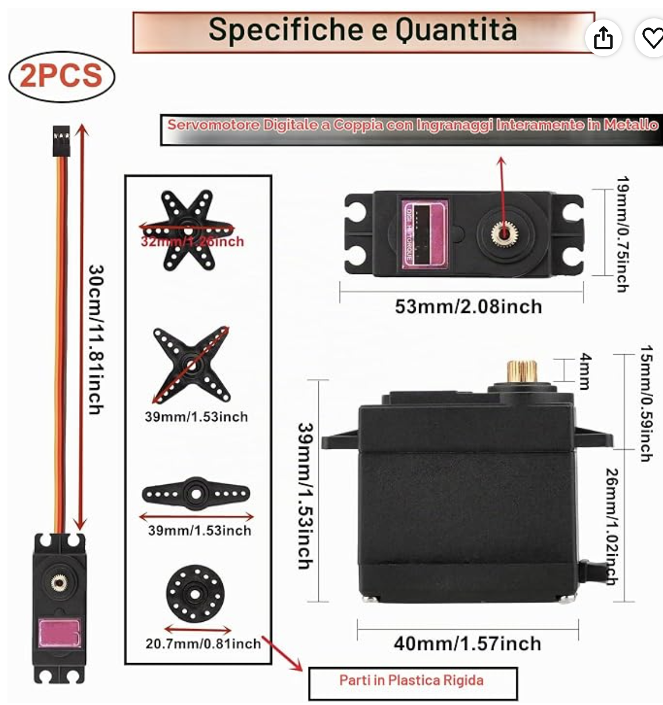
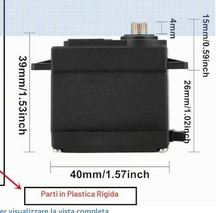

# CAD della base servo–siringa: requisiti e rilievo

Aggiornamento del 12 novembre 2026, sera. **Bozza CAD 03 prodotta** dopo la verifica ingegneristica delle bozze 01 e 02: difetti trovati e correzioni in [README.md](README.md). Resta l'allineamento al centro proposto da Gabriele (servo arretrato di 19 mm, asticella parallela allo scorrimento a 86°). Flangia confermata **37,5 × 25 × 2 mm**. Il progetto è ora verificato automaticamente contro gli errori di misura entro i campi dichiarati; **al 13 novembre tutte le misure di conferma sono state prese e i file per la stampa sono in `da-stampare/`**.

**Metodo aggiornato da Gabriele:** usare lo schema completo e cercare autonomamente il modello su internet per evitare di richiedere quote già documentate. Le eventuali domande riguarderanno soltanto misure necessarie che non risultino disponibili o che non possano essere assorbite dalla regolazione del montaggio.

## Architettura richiesta

Assieme comune per mantenere servo e siringa fermi e allineati: base, supporti dei due componenti e coperchi avvitati rimovibili. La tavoletta di legno esistente resta disponibile come appoggio e ancoraggio.

**Orientamento in valutazione, proposto da Gabriele:** servo in piedi, con alberino rivolto verso l'alto. In questa configurazione il braccio ruota nel piano orizzontale; le alette possono essere appoggiate su supporti stampati e fissate con viti M3 e dadi. Un tetto sopra il corpo non è necessario se il fissaggio sulle alette trattiene già il servo nei due versi di carico. È una proposta da dimensionare, non ancora una disposizione definitiva approvata.

La siringa resta orizzontale su appoggi rialzati: occorre portare il perno dell'asticella all'altezza del foro sul braccio e consentire l'articolazione nel piano orizzontale. Il collegamento allo stantuffo deve avere l'asse di articolazione coerente con il nuovo piano; non assumere che il gancio orientato per il vecchio montaggio sia riutilizzabile senza modifiche. Il riferimento storico di 9 mm dell'alberino sul fianco non definisce l'altezza del nuovo montaggio. Raggio iniziale 35 mm e asticella 110 mm restano i riferimenti da verificare lungo tutta la corsa. La disposizione verticale non garantisce da sola che la base completa entri nel piatto Ø200 mm.

La misura S01 resta utile: mettendo il servo in piedi con l'alberino verso l'alto, corrisponde all'altezza della sola scatola fra fondo e faccia superiore principale, senza alberino o squadretta.

**Adattamento proposto al nuovo vincolo della stampante:** prevedere la possibilità di dividere la base in due moduli con battute di allineamento e collegamento tramite M3, ancorati anche alla tavoletta. Non affidare la rigidità a un incastro lasco. Numero dei moduli e dimensioni finali da verificare dopo il rilievo: la base stampata non deve necessariamente riprodurre tutta la tavoletta di 298,5 × 159 mm.

Ogni pezzo orientato per la stampa, incluse linguette e giunzioni, deve stare nel cerchio disponibile con il margine necessario alla preparazione di stampa. Una base delle dimensioni della tavoletta attuale non entra stampata in piano. Stampare un pezzo lungo in verticale sfruttando i 400 mm di altezza non è l'impostazione scelta per ora; orientamento e robustezza restano da verificare con il professore sul modello.

## Vincoli comunicati dal professore

Fonte: risposta riportata da Gabriele in chat, 12 novembre 2026.

| Voce | Indicazione ricevuta |
|---|---|
| Piatto | Circolare, **diametro 200 mm** |
| Altezza disponibile | **400 mm** |
| Materiale | **PLA basic**, anche marca economica; esempi SUNLU o altro |
| Formato da inviare | **STL** |
| Tolleranza suggerita | **1 mm**; ristampa possibile |
| Fissaggi disponibili | Viti **M3** e dadi; lunghezze e tipo di testa non ancora specificati |
| Tempo da prevedere | **Circa una settimana** dalla consegna del modello pronto, per avere margine; possibile urgenza di due giorni, non assunta come tempo normale |
| Consegna | A lezione |

**Interpretazione della tolleranza ancora da definire:** la risposta non specifica se 1 mm sia il margine totale della sede o per ciascun lato. Conservare questa ambiguità nei parametri di progetto finché non viene risolta con il professore o con una prova di accoppiamento. Non assumere un ritiro uniforme di 1 mm sull'intero STL. Il margine per inserire il componente deve essere recuperabile dal serraggio: a montaggio finito il servo non deve poter muoversi di quel millimetro.

Nessuna bobina comprata o suddivisione del costo con altri gruppi ancora decisa.

## Quote storiche utili

Fonte: `../calibrazione-servo.md`. Queste quote non sono nuove conferme del rilievo per il CAD.

| Componente/riferimento | Quota annotata | Stato per il CAD |
|---|---:|---|
| Corpo servo, due dimensioni | 40 × 19 mm | Da riconfermare e completare con la terza dimensione |
| Fori sulla stessa aletta del servo | Interasse 10 mm | Da riconfermare; restano posizione e spessore delle alette |
| Tavoletta | 298,5 × 159 × 27 mm | Riferimento dell'appoggio esistente |
| Alberino sopra la tavoletta, servo sul fianco | Circa 9 mm | Riferimento geometrico da verificare |
| Foro di lavoro del braccio rispetto all'asse del servo | 35 mm | Riferimento da conservare nel progetto iniziale |
| Asticella fra i due perni | 110 mm | Riferimento da conservare e riconfermare |
| Asticella, diametro | 1,5 mm | Annotato; da verificare per gli accoppiamenti |
| Siringa, diametro esterno | Circa 20 mm | Da misurare con precisione per la sede |
| Siringa, flangia delle alette | 38 × 12 mm; spessore circa 1–2 mm | Da misurare con precisione per il fermo assiale |
| Siringa, lunghezza dalla faccia posteriore delle alette alla punta del cono | 103 mm | Da riconfermare e distinguere dal tratto cilindrico di appoggio |
| Disco dello stantuffo | Diametro 28 mm | Da riconfermare per la corsa e gli ingombri |

## Rilievo: una misura alla volta

| ID | Misura richiesta | Valore confermato |
|---|---|---|
| S01 | Altezza della sola scatola del servo in piedi: dal fondo alla faccia superiore principale, esclusi alberino, squadretta e cavo | **40 mm** — Gabriele: «4 cm», 12 novembre |
| S02 | Lunghezza del corpo visto dall'alto: lato lungo del rettangolo della scatola nera, escluse le alette di fissaggio | **40 mm nominali**, dall'immagine quotata fornita da Gabriele il 12 novembre; non una nuova misura diretta |
| S03 | Larghezza del corpo: lato corto del rettangolo visto dall'alto, perpendicolare alla lunghezza di 40 mm, escluse le alette | **20 mm** — Gabriele: «2 cm», 12 novembre |
| S04 | Servo in piedi: quota inferiore delle alette rispetto al fondo, indicata nello schema laterale completo | **26 mm nominali** — schema completo fornito da Gabriele; domanda di misura diretta superata dal nuovo riferimento |

### Identificazione e quote del servo recuperate dalle fonti

Identificativi forniti da Gabriele: **X002A2MD3B**, **A-SKU/MODEL A097**, **S/N 260718**, marca **HAXIHA**. Il significato specifico del codice X002A2MD3B e del seriale non è stato verificato e non viene usato per dedurre dimensioni.

Verifica diretta della [scheda Amazon del prodotto](https://www.amazon.it/dp/B0F892P2WQ), 12 novembre 2026: marca e produttore HAXIHA, modello e codice produttore **A097**, ASIN **B0F892P2WQ**. La descrizione dichiara **40 × 19 × 43 mm (L × P × A)**. L'identificazione usa la scheda del prodotto già presente nella distinta del progetto, non le quote di un MG996R generico di un altro produttore.

| Quota | Valore nominale da usare come riferimento | Fonte |
|---|---:|---|
| Lunghezza del corpo | 40 mm | Schema completo e descrizione Amazon |
| Larghezza del corpo | 19 mm | Schema completo e descrizione Amazon; Gabriele ha misurato circa 20 mm |
| Altezza indicata del corpo nella vista laterale | 39 mm | Schema completo; Gabriele ha riferito circa 40 mm |
| Sporgenza dell'alberino indicata sopra il corpo | 4 mm | Schema completo |
| Altezza complessiva dichiarata | 43 mm | Descrizione Amazon, coerente con 39 + 4 nello schema |
| Ingombro totale lungo le alette | 53 mm | Schema completo; non è l'interasse dei fori |
| Quota verticale inferiore delle alette | 26 mm | Schema completo |
| Quota verticale superiore indicata accanto alle alette | 15 mm | Schema completo: conservare il riferimento grafico, non trattarla come spessore dell'aletta |
| Lunghezza del cavo | 300 mm | Schema completo |

**Fissaggio da sviluppare nel CAD:** prevedere asole per l'adattamento della posizione delle M3 e appoggi rigidi delle alette, così da ridurre la dipendenza da interassi non quotati nella scheda. Le asole servono alla regolazione prima del serraggio, non a consentire movimenti durante il funzionamento. Prima dell'STL definitivo verificarne la corsa utile, il materiale attorno alle viti e l'appoggio delle rondelle/dadi. Posizione dell'asse rispetto ai bordi, spessore delle alette e interassi non risultano quotati esplicitamente nello schema: non ricavarli come misure certe contando i pixel.

Non sostituire retroattivamente i valori riferiti da Gabriele con quelli nominali: mantenere i due riferimenti e dimensionare le sedi con il margine di montaggio previsto e il serraggio sulle alette. Nessuna ulteriore richiesta di rimisurare S01–S04 è necessaria per procedere al modello preliminare.

### Immagine quotata fornita durante il rilievo

L'immagine riporta la lunghezza del corpo di **40 mm** e un'altezza indicata di **39 mm**; S01 è stata riferita da Gabriele come **40 mm**. Conservare distinti valore misurato e quota nominale della figura: controllare i rispettivi riferimenti geometrici prima di definire le altezze dei supporti. La larghezza S03 non è rappresentata in questa vista. Le quote delle alette andranno lette nei loro riferimenti e confrontate con il pezzo reale prima del CAD definitivo.

Usare il servo di riserva se identico a quello montato; sul montaggio attuale scollegare le alimentazioni prima di manipolare. Le sole quote necessarie non reperibili nelle fonti verranno chieste singolarmente, con riferimenti fisici precisi, e aggiunte qui dopo la risposta.

## Passi successivi

### Ricerca delle dimensioni della siringa PIC da 20 ml

Su richiesta di Gabriele del 12 novembre, cercate online quote da proporre per conferma. Consultate schede del fabbricante Pikdare/PIC e ricerche per diametro esterno, lunghezza del cilindro e disegni dimensionali, anche in inglese e tedesco. **Non è stato trovato un disegno quotato pubblico della specifica siringa del banco, né un diametro esterno verificabile da queste fonti.**

Riferimenti consultati:

- [Scheda tecnica Pikdare: siringhe Luer Lock senza ago fino a 20 ml, revisione 01 del 2019](https://www.sanitex.ch/images/produits/fiches_techniques/seringues_uniques/scheda_tecnica_SIRINGHE_LUER_LOCK_SENZA_AGO_fino_a_20ml_-_rev_01_ing.pdf): comprende PIC 20 ml codice 02077000090500; materiali, graduazione, capacità e codici, senza quote esterne di cilindro o flangia. **È la variante Luer Lock, non è identificata come la siringa a cono semplice del banco.**
- [Scheda tecnica Pikdare: Luer centrale senza ago, revisione 02 del 2021](https://www.sanitex.ch/images/produits/fiches_techniques/seringues_uniques/scheda_tecnica_SIRINGHE_LUER_CENTRALE_SENZA_AGO_-_rev_02_ing.pdf): tabella delle varianti da 1 a 10 ml; non fornisce una siringa da 20 ml con quote utilizzabili.

Le quote riportate in «Quote storiche utili» provengono dalle misure del progetto del 19–21 ottobre; **non vanno presentate come dimensioni trovate online**. Sono il riferimento disponibile da proporre a Gabriele per conferma: diametro esterno circa 20 mm, flangia 38 × 12 mm con spessore circa 1–2 mm, lunghezza dalla faccia posteriore delle alette alla punta del cono 103 mm, disco dello stantuffo 28 mm, distanza fra tacche 0 e 20 ml 70 mm. Il diametro interno calcolato dalla capacità e dalla corsa non sostituisce il diametro esterno per il supporto.

| ID | Quota proposta per conferma | Origine e stato |
|---|---|---|
| P01 | Diametro esterno del cilindro trasparente: **circa 21 mm** | Gabriele ha misurato una circonferenza di **66 mm** con una strisciolina di carta il 12 novembre: 66 / π ≈ 21,0 mm. Prima stima diretta 20–21 mm; il valore storico di circa 20 mm è aggiornato per il CAD |
| P02 | Dalla faccia posteriore delle alette alla punta del cono, senza ago né tubo: **105 mm** | Gabriele: «10,5 cm», 12 novembre; aggiorna il riferimento storico di 103 mm per il CAD |
| P03 | Ingombro massimo delle alette da punta a punta, trasversalmente alla siringa: **37,5 mm** | Gabriele: «3,75 cm», 12 novembre; aggiorna il riferimento storico di 38 mm per il CAD |
| P04 | Spessore della plastica di un'aletta, misurato lungo l'asse della siringa, guardando l'aletta di taglio: **2 mm** | Gabriele: «2 mm», 12 novembre; conferma il limite superiore della stima storica di 1–2 mm |
| P05 | Diametro del disco di spinta dello stantuffo (appoggio del pollice): **28 mm** | Gabriele: «2,8 cm», 12 novembre; conferma il riferimento storico |
| P06 | Distanza assiale fra le tacche 0 e 20 ml sul cilindro: **70 mm** | Confermata da Gabriele il 12 novembre |
| P07 | Stantuffo a 0 ml, beccuccio libero: distanza dalla faccia delle alette rivolta verso lo stantuffo alla faccia interna del disco del pollice (quella rivolta verso le alette), lungo l'asse della siringa: **16 mm** | Gabriele: «16mm», 12 novembre; aggiorna il riferimento storico di 15 mm per il CAD |
| P08 | Larghezza minore di una delle alette, vista di faccia: dimensione perpendicolare alla larghezza totale di 37,5 mm, misurata sulla sola parte sporgente dell'aletta: **8 mm** | Gabriele: «8 mm», 12 novembre; sostituisce il riferimento storico di 12 mm per questa specifica dimensione della parte sporgente, senza assumere che l'intera flangia abbia altezza 8 mm |
| P09 | Asse corto dell'intera flangia ovale, da bordo a bordo passando per il centro dell'apertura del cilindro, perpendicolare alla larghezza totale di 37,5 mm: **25 mm** | Gabriele: «25mm», 12 novembre; distinta dalla misura parziale P08. Ingombro completo della flangia per il CAD: **37,5 × 25 × 2 mm** |

**Riscontro fotografico:** Gabriele ha fornito `/Users/gabrielecaruso/Downloads/IMG_2544.HEIC`, conservata come riferimento visibile in [`riferimenti/siringa-flangia-IMG_2544.jpg`](riferimenti/siringa-flangia-IMG_2544.jpg). La foto mostra una **flangia ovale continua** attorno al cilindro, non due linguette rettangolari isolate. Righello disposto lungo l'asse maggiore; il punto di vista obliquo permette di capire il contorno, ma non viene usato per ricavare quote precise dai pixel. Per il profilo della sede serve l'asse corto complessivo P09: non usare 8 mm o i vecchi 12 mm come altezza totale della flangia, che circonda il cilindro da circa 21 mm.

### Sequenza di lavoro

1. **Bozza 03 prodotta:** base 283 × 86 mm in due moduli, servo appeso alle alette, testata rigida per la flangia, sedici M3×16 tutte uguali. Esplorare `bozza-03/APRI-IL-CAD.html`. Bozze 01 e 02 conservate per confronto.
2. Misure di conferma completate il 13 novembre (tabella in fondo). Se cadono nei campi indicati il modello non cambia; altrimenti si corregge la quota in `modello.cjs` e si rigenera. Corsa nominale della bozza 03: 1,94–18,06 ml nei comandi 36–146°, circa 10,2 ml al centro. Non è una nuova misura o calibrazione al banco.
3. Chiedere al professore conferma della viteria (M5) e concordare pareti, riempimento e brim nello slicer.
4. Consolidare gli STL dei singoli pezzi dopo i controlli reali e la revisione nello slicer. I sei STL BOZZA hanno mesh chiuse a guscio unico e ingombro entro il piatto previsto; non sono ancora un’autorizzazione alla stampa.
5. Dopo la stampa: montaggio, misura del gioco, prova 4.4 e nuova prova di tenuta M4. In parallelo si possono preparare software, simulazioni e documentazione delle fasi successive, senza dichiararne conclusa la validazione al banco.

## Misure di conferma per la revisione 03

Tutte prese da Gabriele con il righello il 13 novembre 2026 e inserite nel modello.

| ID | Misura | Valore | Effetto sul modello |
|---|---|---|---|
| M1 | Interasse lungo dei fori delle alette, dal bordo sinistro di un foro al bordo sinistro del foro corrispondente sull'altra aletta | **47,5 mm** (riportato come «47,5 cm circa», letto in millimetri) | Fori dei pilastrini a 47,5 mm; il progetto regge fra 46 e 49 mm |
| M1 bis | Ingombro delle alette da punta a punta | **55 mm** | Sostituisce i 53 mm dello schema |
| M1 ter | Distanza fra i due fori della stessa aletta | **9 mm** | Coerente con i 10 mm del modello, entro il gioco dei fori |
| M2 | Altezza dal fondo alla faccia inferiore delle alette | **30 mm** | Sede delle alette a 30,5 mm; regge fra 28 e 32 mm. Lo schema riportava 26 mm |
| M3 | Altezza dal fondo al centro dell'uscita del cavo | **8 mm** | Tunnel del cavo rialzato; regge fra 5,5 e 10,5 mm |
| M4 | Distanza dalla faccia della scatola al braccio | **8 mm alla faccia interna, 14 mm a quella esterna**, per una sporgenza del braccio | Piano dell'asticella a 12,5 mm e asse della siringa a 10,5 mm sopra la scatola, a metà del campo |
| M5 | Viteria | Sedici M3×16 con dadi e rondelle, acquistate da Gabriele | Servono solo al montaggio |

I file per il professore sono in `da-stampare/`, con le impostazioni proposte in `da-stampare/LEGGIMI-STAMPA.txt`.

### Correzioni del 18 novembre dopo la controanalisi

Una seconda analisi indipendente ha segnalato quattro punti; verificati sulla geometria:

- **Passacavo che si incastra scendendo:** confermato. Dallo schema sporge oltre 5 mm dal corpo; la gola lasciava 2,95 mm. Sostituita da una fessura passante larga 5 mm.
- **Canale dei dadi che sfonda nella sede del servo:** confermato, di 0,675 mm. Un dado M3 non sta a 3,75 mm dalla scatola senza sfondare in nessun orientamento: i pilastrini ora hanno fori autofilettanti da 2,6 mm. La soluzione proposta (dadi inseriti di lato e gola larga 5,5–6 mm) è geometricamente impossibile: con fori a 9–10 mm fra loro, dadi e gola si sovrapporrebbero.
- **Interasse corto 9 mm misurato contro 10 nel modello:** incoerenza reale, anche se ancora entro le tolleranze. Ora 9,5 mm.
- **Prolunga del braccio e gancio sullo stantuffo:** osservazione corretta ma fuori dalla stampa; già indicata come limite. Aggiunta al montaggio la rotazione dello stantuffo.

