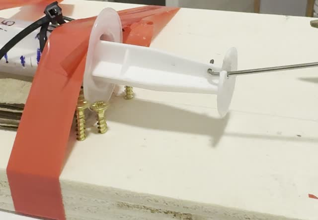
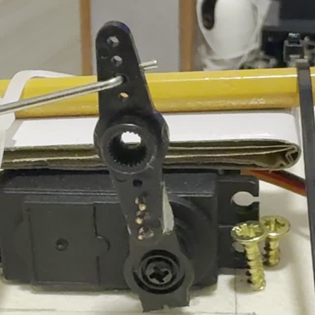

# Intervento sul servo (R3): preparazione del 12 novembre 2026

**Stato:** guida preparata lontano dal banco. Nessuna riparazione eseguita, nessun acquisto effettuato e nessuna nuova prova al banco. **M4 non ancora dichiarata**, per decisione di Gabriele del 12 novembre; le due prove superate del 10 restano documentate.

**Sviluppo attuale del CAD:** prodotta la **BOZZA 02**, con servo verticale arretrato di 19 mm per allineare l’asticella allo scorrimento al centro, base comune 297 × 86 mm in due moduli, sei STL preliminari e anteprima 3D in `cad-base/bozza-02/APRI-IL-CAD.html`. Istruzioni in [`cad-base/README.md`](cad-base/README.md), quote e provenienza in [`cad-base/requisiti-e-misure.md`](cad-base/requisiti-e-misure.md). Flangia: 37,5 × 25 × 2 mm. Verificati mesh, piatto Ø200 mm e moto nominale; interassi, trasmissione reale, viteria, tolleranze e preparazione della stampa restano da verificare. Prima misura richiesta: interasse lungo dei fori sulle alette, ipotizzato 49 mm. Nessuna stampa o riparazione eseguita. La bozza 01 e le alternative sotto documentano il ragionamento precedente.

## 1. Materiali e vincoli confermati

- Disponibili: cacciaviti, pinze, viti per legno, martello, chiodi, fascette e nastro isolante.
- Non disponibile: trapano. Presenza di ritagli di legno rigido da verificare.
- Gabriele può andare al brico per il materiale necessario. Questo non equivale a un acquisto già deciso.
- Possibile aiuto del padre con trapano e attrezzi per lavorare il legno **il 28 novembre**. Attendere quella data è un'opzione, non una modifica al calendario già approvata.
- **Nuova risorsa comunicata il 12 novembre:** il professore ha offerto di progettare (oppure ricevere il progetto) e stampare gratuitamente un componente in 3D. È un'opzione da valutare prima di comprare un supporto o intagliare la tavoletta; nessun pezzo ancora scelto, progettato in CAD o richiesto al professore.

## 2. Riscontro della ripresa fornita da Gabriele

Sorgente: `/Users/gabrielecaruso/Downloads/IMG_2485 2.MOV`, circa **29,72 s**, ripresa del 10 novembre. Esame visivo tramite fotogrammi distribuiti sull'intera ripresa e sequenza più fitta fra 14 e 20 s. Due dettagli estratti sono conservati qui; la sorgente è intatta.

| Intervallo indicativo | Cosa mostra | Cosa controllare al banco |
|---|---|---|
| 0–9 s | Attacco dell'asticella alla nervatura dello stantuffo, vicino al disco bianco | Quanto movimento dell'asta viene assorbito dal gancio prima che lo stantuffo trasli; distinguere questo dal cambio di inclinazione necessario allo snodo |
| 10–29 s | Corpo del servo sul fianco, viti accanto al corpo, serraggio superiore con cartone, due squadrette sovrapposte per ottenere la prolunga | Corpo rispetto alla tavoletta; due squadrette l'una rispetto all'altra; mozzo rispetto all'alberino |





**Riferimento importante nell'immagine del servo:** il vero asse del motore è il mozzo **in basso**, con la vite a croce. Il cerchio grande più in alto appartiene alla seconda squadretta usata come prolunga.

La ripresa permette di riconoscere i collegamenti, ma non separa quantitativamente gioco degli ingranaggi, flessione della prolunga, cedimento del fissaggio e gioco dello snodo. **22°** è la misura complessiva al banco del 10 novembre, non una nuova misura ricavata da queste immagini. La ripresa è a mano libera: lo spostamento di un pezzo va confrontato con riferimenti vicini, non con il bordo del fotogramma.

## 3. Geometria da mantenere come riferimento

Misure storiche da `calibrazione-servo.md`, da ricontrollare sul montaggio attuale:

| Riferimento | Misura annotata |
|---|---:|
| Tavoletta, misura del 18 ottobre | 298,5 × 159 × 27 mm |
| Centro dell'alberino sopra la tavoletta, servo sul fianco | circa 9 mm |
| Distanza fra asse del servo e foro di lavoro della prolunga | 35 mm |
| Asticella, distanza fra i perni | 110 mm |
| Asse della siringa sopra la tavoletta | circa 21 mm |
| Perno nella nervatura dello stantuffo | circa 4 mm sopra l'asse della siringa |
| Comando con braccio verticale | 86° |
| Limiti attuali nel firmware | 36–146° |

L'allineamento da controllare è quello fra **braccio, asticella e perno dello stantuffo**. Il beccuccio a cui si collega il tubo pneumatico non è il riferimento del manovellismo. Il collegamento deve poter cambiare inclinazione senza impuntarsi e senza spingere lateralmente lo stantuffo.

L'asticella non deve rimanere orizzontale per tutta la corsa: la sua inclinazione cambia mentre il foro sul braccio descrive un arco. Prima di cambiare altezze o lunghezze, eliminare i cedimenti dei fissaggi e ricontrollare tutta la corsa.

## 4. Fissaggio del corpo: soluzioni da dimensionare

### C. Supporto su misura stampato in 3D (nuova possibilità)

**Prima proposta da valutare alla luce dell'offerta del professore:** una culla smontabile per il servo sul fianco, con arresti laterali, ritenuta contro il sollevamento e punti di fissaggio alla tavoletta. È una proposta funzionale, non ancora un CAD pronto per la stampa o una scelta approvata da Gabriele.

Requisiti da portare al progetto:

- Il corpo deve restare fermo rispetto alla tavoletta nei due versi di carico. Prevedere appoggi rigidi e ritenuta sulle alette o sul corpo, con serraggio tramite viti e dadi metallici.
- Valutare una culla **aperta sotto**, con il servo ancora appoggiato alla tavoletta, per conservare l'altezza attuale dell'alberino. Una base stampata sotto il corpo lo alzerebbe: in quel caso l'altezza nuova va verificata insieme al manovellismo.
- Lasciare libero il cavo, accessibile la vite del mozzo e libero il volume spazzato dal braccio nell'intera corsa. Il montaggio deve poter essere smontato.
- Prevedere fori/asole per le viti nel legno; riutilizzare i fori esistenti solo se posizione e tenuta lo permettono. La stampa può fornire i fori del supporto, ma non fora la tavoletta.
- Dimensionare pareti e nervature per il carico e scegliere l'orientamento di stampa rispetto alle sollecitazioni; materiale e impostazioni da concordare con chi stampa. Il [PETG è un candidato usato per supporti e morsetti](https://help.prusa3d.com/article/petg_2059), non una garanzia di rigidità indipendente dalla geometria.
- Prevedere il gioco di montaggio necessario per inserire il servo e poi bloccarlo: **non** progettare l'incastro assumendo che CAD e stampa abbiano esattamente la stessa misura. [Indicazioni Prusa su tolleranze e orientamento](https://help.prusa3d.com/article/modeling-with-3d-printing-in-mind_164135).

La sede stampata svolgerebbe la funzione dell'incasso proposto da Gabriele, con una forma sostituibile e verificabile prima di modificare il legno. Resta necessario misurare il servo reale: i dati nominali «MG996R» non definiscono da soli alette e ingombri del nostro esemplare.

**Altri componenti utili, in ordine successivo:**

| Pezzo | Scopo | Vincolo da conservare |
|---|---|---|
| Prolunga rigida in un solo pezzo, avvitata alla squadretta originale | Eliminare la giunzione cedevole fra le due squadrette attuali | Foro dell'asticella a 35 mm dal vero asse del servo; conservare il mozzo scanalato originale e verificarne il serraggio |
| Attacco allo stantuffo con perno metallico | Trasmettere spinta e trazione riducendo il movimento a vuoto | Snodo ancora libero di articolarsi; nessuna deformazione o rottura della nervatura dello stantuffo |

Per la prima versione eviterei di stampare anche la dentatura che si innesta sull'alberino: si può mantenere la squadretta originale e avvitare su quella la prolunga stampata. La compatibilità dei fori e la rigidezza del collegamento richiedono comunque verifica.

Il supporto del corpo, da solo, non elimina il gioco residuo degli ingranaggi o degli altri collegamenti. L'effetto di ciascun intervento va verificato con la misura del gioco e poi con la 4.4. Nessuna promessa di recuperare automaticamente l'assestamento sotto 0,5 s.

### A. Supporto già forato che trattiene le alette

Alternativa commerciale: un supporto per il montaggio sul fianco di un servo standard, fissato alla tavoletta. Deve trattenere il corpo anche contro il sollevamento e lasciare libero il braccio.

Un esempio reale è il [Pololu 3435](https://www.pololu.com/product/3435), che aggancia le alette del servo. **Non è ancora dichiarato compatibile con il nostro MG996R HAXIHA:** il produttore richiede di confrontare le dimensioni e lo spessore delle alette. I fori di fissaggio del supporto sono previsti per M3; non forzare le viti per legno da 3,5 mm dentro fori più piccoli. [Disegno quotato del produttore](https://www.pololu.com/file/0J1580/mounting-bracket-for-standard-size-servos-dimensions.pdf).

Anche due squadrette metalliche possono fare da supporto, ma posizione dei fori o delle asole e spazio disponibile devono corrispondere alle alette reali. La sola dicitura «per MG996R» o «servo standard» non basta a confermare il montaggio nella nostra posizione.

**Materiale da scegliere dopo le misure:** un supporto compatibile (oppure due squadrette adatte), viti di ancoraggio alla tavoletta, eventuali viti passanti con dadi e rondelle compatibili con le alette.

### B. Culla esterna in legno con fermo superiore

Alternativa da costruire sulla tavoletta, mantenendo il servo alla quota attuale. Due arresti rigidi limitano lo spostamento laterale; un fermo superiore avvitato impedisce il sollevamento. Il fermo va sul corpo, lasciando liberi cavo, alberino e braccio.

Schema di principio, sezione trasversale; **non in scala e non ancora un disegno esecutivo**:

```text
             fermo superiore rigido
           ┌─────────────────────┐
           │                     │
        vite                     vite
           ↓                     ↓
       ┌────────┐  ┌─────────┐  ┌────────┐
       │supporto│  │  SERVO  │  │supporto│
       │ laterale  │         │  │laterale│
       └────────┘  └─────────┘  └────────┘
    ═══════════════ tavoletta ═══════════════
```

Il fermo deve appoggiare sul corpo del servo; i supporti laterali e il serraggio vanno dimensionati per ottenere questo contatto senza deformare la scatola. Anche i supporti devono essere ancorati alla tavoletta. Cartone, nastro e fascette non sostituiscono questi vincoli rigidi.

**Materiale da dimensionare:** blocchetti/listelli rigidi per due arresti e un fermo superiore, viti e rondelle. Se servono tagli, farseli preparare in negozio oppure lavorarli con gli attrezzi disponibili il 28 novembre.

Per i piccoli prefori delle viti nel legno si può valutare un **trivellino manuale (succhiello)**: esistono utensili manuali di piccolo diametro, ad esempio il [set BGS 2022](https://www.bgstechnic.com/en/products/hand-tools/drills/wood-drills/auger-set-2-5-5-mm-4-pcs.html). Diametro e profondità del preforo vanno scelti in base a vite e legno. Questo utensile non risolve tagli, forature di metallo o costruzione della culla; non garantisce da solo che l'intervento sia realizzabile con il materiale attuale.

### E l'incasso proposto da Gabriele?

Una sede sagomata può bloccare gli spostamenti laterali, ma serve comunque una ritenuta contro il sollevamento. Non è necessario scavare la tavoletta per ottenere un buon fissaggio: una culla esterna può svolgere la stessa funzione.

Abbassando il servo cambiano la quota dell'alberino e lo spazio libero sotto il braccio. Nel montaggio originale il ramo corto della squadretta era già stato accorciato per evitare che toccasse la tavoletta. Perciò profondità e sagoma di un eventuale incasso richiedono le misure reali e la verifica dell'intera corsa; non si ricavano dal solo contorno del motore.

## 5. Gli altri due interventi

**Prolunga.** Le due squadrette devono comportarsi come un unico pezzo. Controllare il loro movimento relativo: se la giunzione cede, valutare due fissaggi passanti distanziati, nei fori compatibili, oppure una squadretta unica del raggio adatto e con mozzo compatibile. Per viti, dadi e fori non è ancora fissato un diametro. Mantenere il raggio di lavoro di 35 mm come riferimento: un braccio più corto cambierebbe corsa e guadagno della trasmissione.

**Gancio allo stantuffo.** Controllare gioco del foro, deformazione dell'asticella e tratto piegato. Lo snodo deve poter ruotare per seguire il manovellismo, ma non spostarsi avanti e indietro a vuoto prima di trascinare lo stantuffo. Un eventuale perno con fermo deve conservare questa libertà: incollare rigidamente lo snodo può farlo impuntare.

## 6. Misure per completare la lista di acquisto

Al banco, con alimentazioni scollegate e collegamento pneumatico della siringa aperto prima di sganciare la trasmissione:

1. Controllare spessore e stato della tavoletta attuale; la misura storica è 27 mm.
2. Misurare corpo del servo, spessore delle alette, distanza fra i fori e altezza dei fori sopra la tavoletta. Servono al supporto, non al solo contorno del servo.
3. Verificare lo spazio disponibile per supporto, testa delle viti e corsa del braccio; conservare i riferimenti della posizione attuale prima di smontare.
4. Verificare diametro dei fori già presenti nelle due squadrette della prolunga e lo spazio per dadi/rondelle.

Si può portare al negozio il servo di riserva, se disponibile e uguale a quello montato, per confrontare i supporti senza smontare il banco. Serve comunque verificare l'ingombro del montaggio completo. Nessun prezzo o disponibilità nel brico locale è stato verificato.

## 7. Ordine dell'intervento e delle nuove prove

1. **Fissaggio del corpo:** nessun sollevamento o scorrimento rispetto alla tavoletta sotto il carico di lavoro.
2. **Giunzione della prolunga:** nessun movimento relativo apprezzabile fra le due squadrette.
3. **Attacco allo stantuffo:** snodo libero di articolarsi, con il movimento a vuoto ridotto.
4. **Corsa:** riconfermare centro e limiti senza urti; se la geometria cambia, i vecchi angoli non sono automaticamente validi. La prima attivazione del servo va gestita dalla posizione in cui si trova realmente, come da procedura di accensione del progetto.
5. **Gioco:** nuova misura a passi di 2° dopo un'inversione, ripetuta nei due versi. Confrontare con i 22° del 10 novembre; i 10° di ottobre sono un riferimento storico, non un nuovo criterio di accettazione.
6. **4.4:** nuova sessione con P1 e soglia ricontrollati; rimettere il PI tarato `K,P,0.02,0.1` (all'avvio il firmware usa ancora 0,02/0,4). Rifare i gradini di pressione registrati: obiettivo di assestamento **< 0,5 s**. Non riutilizzare il p0 del 10 novembre come se fosse quello attuale.
7. **M4:** nuova verifica della tenuta di quota e decisione di Gabriele sulla dichiarazione. Il criterio resta **60 s entro ±1 cm**.

Dopo due prove fallite, cercare la causa con una misura prima di un altro tentativo. Una compensazione software del gioco resta un'opzione successiva, da valutare sul gioco residuo misurato dopo l'intervento.

## Fonti

- Progetto: `calibrazione-servo.md` (misure e geometria), `../diario.md` (10 e 12 novembre), `../relazione/05-controllo.md` (5.5–5.6), `../firmware/src/palombaro/siringa.h` (limiti attuali e primo comando).
- Ripresa fornita da Gabriele: `IMG_2485 2.MOV`, percorso completo indicato sopra; fotogrammi estratti localmente.
- Pololu: scheda e disegno del supporto 3435, consultati il 12 novembre 2026; esempio di soluzione, compatibilità con questo servo da verificare.
- BGS technic: scheda set 2022 di trivellini manuali, consultata il 12 novembre 2026; esempio di utensile per il legno, nessuna disponibilità locale confermata.
- Prusa Research: guide sul PETG e sulla progettazione per la stampa 3D, consultate il 12 novembre 2026; riferimenti per il progetto, non specifiche già scelte per il pezzo.
