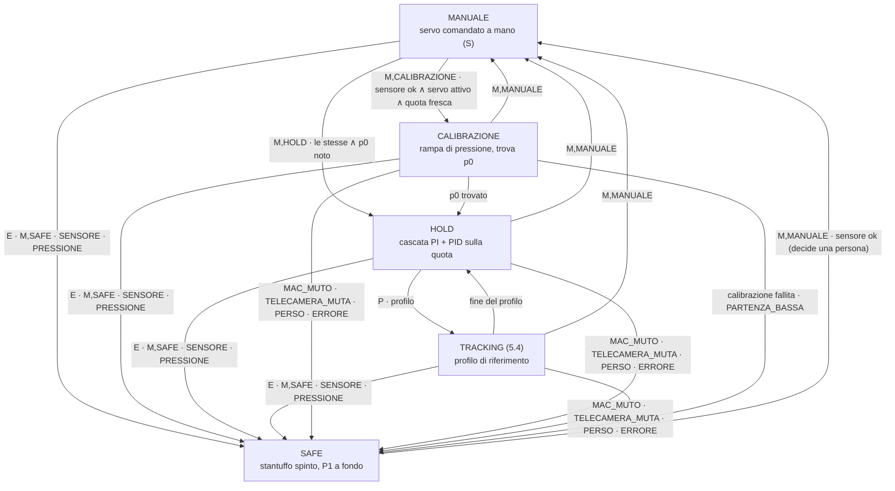

# 6. Il supervisore: SFC, automa e rete di Petri

Lavoro della sottofase 5.7, preparato il 19 novembre lontano dal banco. Il modello ricopia le regole del firmware 0.2 (`firmware/src/palombaro/principale.cpp`, `supervisore.cpp`); la verifica è in `analisi/supervisore.py`, con i test in `tests/test_supervisore_modello.py`.

## 6.1 SFC

## 6.2 Automa e rete di Petri

**Automa:** stati MANUALE, CALIBRAZIONE, HOLD, SAFE (più TRACKING come progettato per la 5.4); eventi = comandi del Mac (M, E, S, K, P), eventi del firmware (calibrazione fatta o fallita, fine del profilo) e guasti rilevati dal supervisore (sensore, sovrapressione, Mac muto, telecamera muta, P1 perso, errore grande per troppo tempo).

**Rete di Petri:** un posto per ogni stato, con un solo token, e due posti complementari per ogni condizione che le transizioni leggono o cambiano: sensore ok/ko, servo attivo/spento, quota fresca/vecchia, p0 noto/ignoto. Una condizione letta senza cambiarla è un arco in ingresso e uno in uscita sullo stesso posto. Marcatura iniziale: MANUALE, sensore ok, servo spento, quota vecchia, p0 ignoto.

## 6.3 Proprietà verificate sul grafo di raggiungibilità

| proprietà | firmware 0.2 | con TRACKING |
|---|---|---|
| P1 rete 1-limitata, un solo stato marcato | verificata (44 marcature) | verificata (48) |
| P2 nessun blocco: in ogni marcatura c'è una transizione abilitata | verificata | verificata |
| P3 SAFE raggiungibile da ogni marcatura, in un passo dagli altri stati | verificata | verificata |
| P4 da SAFE si esce solo verso MANUALE | verificata | verificata |
| P5 stati automatici solo con servo attivo; HOLD e TRACKING solo con p0 noto | verificata | verificata |
| P6 ogni stato è raggiungibile | verificata | verificata |
| P7 da ogni marcatura si torna a MANUALE | verificata | verificata |

Le 8 marcature di SAFE con il sensore guasto sono un blocco voluto: nessun comando porta fuori da SAFE finché il sensore non risponde di nuovo (l'uscita verso MANUALE richiede il sensore). I test controllano anche che la verifica funzioni: un'uscita SAFE → HOLD inserita apposta viene scoperta (P4 e P5 falliscono), e così un ingresso in HOLD senza p0 noto.

**Limiti del modello.** Non ha il tempo: le soglie (Mac muto dopo 2 s, telecamera muta dopo 2,5 s, errore oltre 6 cm per più di 5 s) sono rappresentate come eventi già accaduti. Le proprietà riguardano la logica degli stati, non la velocità della reazione, che resta da misurare al banco (5.6).
